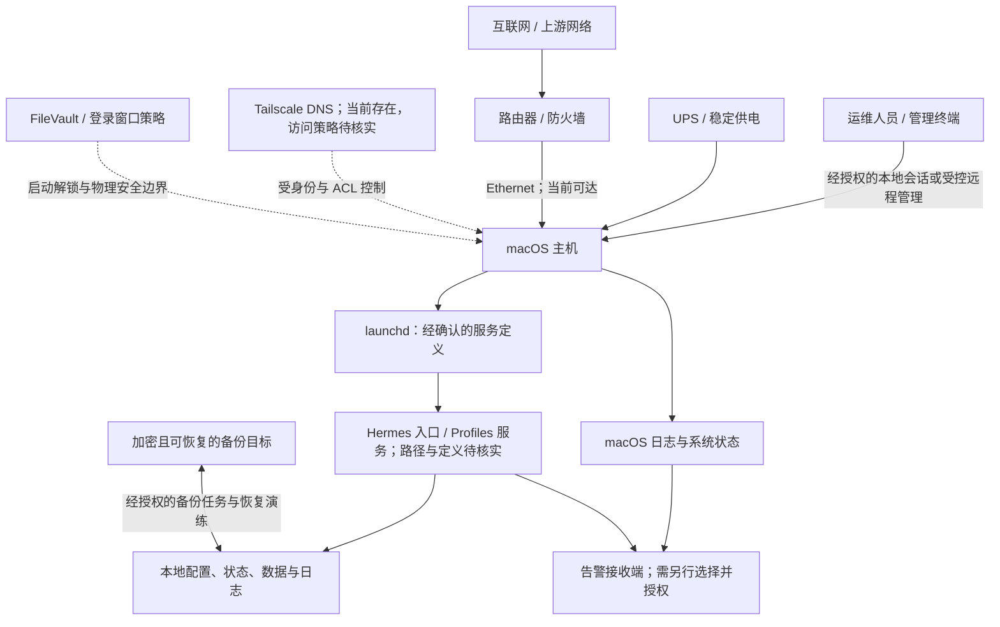

# 本机 macOS 7×24 Hermes 服务主机实施步骤与运维手册

> **执行边界：本轮只编写本手册，不执行任何配置改动。** 下文中的命令均为候选操作示例，当前均未执行；涉及 `sudo`、系统服务、休眠策略、FileVault、自动登录、网络或磁盘变更的命令，必须先由用户逐项确认，再按检查点实施。未经确认不得复制执行。
>
> **运行目标：** 在现有 macOS 主机上，以可审计、可回滚的方式承载 Hermes 长期服务。7×24 是目标，不是无故障承诺；硬件、供电、网络、macOS 更新、服务自身及第三方依赖都可能中断服务。

## 1. 架构图



**边界说明**
- `launchd` 负责进程生命周期，不代替 Hermes 应用内部的任务调度器。须先确认 Hermes 是常驻进程、Scheduler 任务，还是由 Profiles 生成的服务，避免重复启动。
- 网络入口应遵循最小暴露原则。默认不将服务端口映射到公网；需要远程访问时，先确认身份验证、Tailscale ACL/DNS、监听地址及防火墙规则。
- 配置、密钥、运行数据、日志和备份须分开治理。备份需加密、限制访问并验证可恢复性；不能只备份 LaunchAgent/Daemon plist。
- UPS、路由器、Mac 和备份目标是可用性链路的一部分。单机 7×24 仍有硬件及维护窗口风险。

## 2. 已知现状与安全审计

### 2.1 已知事实（仅作为本次规划依据）

- 芯片信息：M5 Max，18 核；可用磁盘空间约 861 GiB。该空间是当前观测值，不代表长期容量或可用内存。
- `pmset`：AC 下 `sleep=1`、`autorestart=0`、`displaysleep=10`、`disksleep=10`。当前睡眠被 RustDesk、Electron、`powerd`、`coreaudiod` 等进程阻止；阻止睡眠属于当前状态，不是可靠的持久化服务策略。
- `fdesetup` 显示 FileVault Off。
- macOS 防火墙已启用；Ethernet 当前可达；存在 Tailscale DNS 配置，但其 ACL、出口、路由和实际可访问范围尚未核验。
- LaunchAgents 目前只见 Google 项；LaunchDaemons 中有 RustDesk plist。Hermes 与 Scheduler 的安装、运行及定义均未知。
- `systemsetup` 查询因需要管理员权限受阻；`top`/`ps` 查询因沙箱权限受阻。不能据此推断系统设置或进程状态。

### 2.2 风险审计与控制措施

| 风险 | 影响 | 控制与实施前检查 |
|---|---|---|
| 休眠或断电导致服务停止 | Hermes 无法持续响应；未落盘任务可能丢失 | 区分显示器睡眠与系统睡眠；先确认设备类型、供电与 UPS，再经批准调整 AC 策略；不得把进程临时阻止睡眠当作服务保障 |
| FileVault 关闭 | 设备被盗或离线访问时，数据保护较弱 | 明确静态数据威胁模型、密钥托管和恢复责任；开启后重启可能停在登录/解锁界面，需要人工输入凭据。不得把自动登录视为 FileVault 无人值守解锁方案 |
| 自动登录或共享管理员凭据 | 物理接触者可直接进入用户会话；凭据暴露范围扩大 | 默认禁用自动登录；如业务必须使用，先书面接受风险、限定物理环境和账户权限，并验证 FileVault 与自动登录的兼容约束 |
| 以 root 或宽松权限运行服务 | 配置/插件缺陷可能扩大为整机失陷 | 优先以专用非管理员账户运行；只授予必要目录读写；不把密钥放入 plist、命令行参数或公开日志 |
| 网络暴露与远程管理 | 未授权访问、凭据攻击或横向移动 | 保持防火墙；核对监听地址、端口、RustDesk/Tailscale 控制面与 ACL；不因服务不可达而直接开放公网端口 |
| 错误的 launchd 定义或重复调度 | 重复任务、启动风暴、环境不一致 | 先识别 Hermes 官方入口、Profiles 与 Scheduler 的职责；采用绝对路径、专用日志、明确用户/域；变更前备份并验证 plist |
| 更新及备份不完整 | 更新回归、配置丢失或无法恢复 | 维护前备份配置和数据；记录版本；小范围验证；定期进行隔离恢复演练。不能仅以“备份任务成功”视为可恢复 |
| 日志、告警包含敏感数据 | 密钥、提示词、个人数据泄漏 | 检查日志字段与保留期；限制文件权限；告警只发送必要状态，不发送令牌或完整业务负载 |
| 自动重启策略造成重复启动或任务不一致 | 异常断电后服务状态不可预期 | 明确 Hermes 幂等性、未完成任务处理和启动依赖；先评估 `autorestart`，不要仅为 7×24 目标盲目启用 |

**安全基线结论：** 当前 FileVault 关闭是优先评估项；自动登录默认不启用；不新增公网入口；不以未知路径或猜测的 Hermes 配置生成服务定义。FileVault、开机自动启动与无人值守解锁存在物理安全和可用性的取舍，须先确定登录窗口需求及现场值守能力。

## 3. 实施原则与阶段检查点

按“先计划、用户确认、逐项实施、每项执行后 PASS/PARTIAL 验证”的方式推进。每项仅实施已明确批准的变更，不捆绑执行。任一检查为 PARTIAL 或 FAIL 时暂停后续变更，记录证据、影响和下一步选择。**本轮不执行下列任何步骤。**

### 3.1 按难易程度排序的实施路线与预期效果

以下排序从易到难，难度综合考虑权限提升、业务中断风险、回滚复杂度及对整机安全边界的影响。每一项均明确列出**实施前现状**、**实施后达到的具体效果**以及**对应的闭环验证方式**。

| 顺序 | 难度 | 工作项 | 实施前现状 | 实施后达到的具体效果 | 验证方式与通过标准 (PASS Criteria) |
|---:|---|---|---|---|---|
| 1 | 低 | 补齐只读基线与环境事实 | 当前通过沙箱环境查询存在 `systemsetup`、`ps` 权限限制；Hermes 确切路径及版本未完全固化 | 建立唯一事实真相表（macOS 精确 build、机型架构、Hermes 二进制路径、Profiles 及 Scheduler 定义），后续变更不再基于猜测 | 运行 `sw_vers`、`which hermes`、检查对应 profile 配置文件；确认路径真实存在且可执行；记录时间戳与校验哈希 |
| 2 | 低 | 监控指标、日志轮转与告警模板建立 | 缺乏系统级与应用级的异常告警通道；日志可能无序膨胀或包含敏感信息 | 形成规范的日志结构（脱敏存储）；系统磁盘余量、服务进程存活、任务连续失败事件可通过指定通道通知 | 触发模拟告警探针，确认测试通知送达；检查日志目录具有写入权限及预设轮转（如单文件上限与天数归档） |
| 3 | 低—中 | 数据与配置备份及隔离恢复演练 | 缺乏独立的配置副本与演练证据；存在配置篡改无法回滚风险 | 确立包含 Hermes profiles、任务数据库、plist 与系统配置基线的加密备份；具备从零还原能力 | 在 `/tmp` 或独立沙箱目录执行恢复脚本，验证配置文件完整性与数据库可读性；记录实测 RTO/RPO |
| 4 | 中 | 交流电系统休眠策略调整 (AC sleep=0) | 当前 `sleep=1`，虽有 RustDesk/Electron 临时阻止，但进程退出后主机会随时挂起中断服务 | 主机在交流电供电下彻底保持系统唤醒（System Awake），同时保持显示器在 10 分钟后正常熄屏节能 | 1. `pmset -g custom` 确认 AC 下 `sleep 0`、`displaysleep 10`；<br/>2. 观察主机进入无外设操作且屏幕熄灭 15 分钟后，从网络端发起 ping 与健康探针，响应无中断 |
| 5 | 中 | 断电自动重启与供电保护 (autorestart=1) | 当前 `autorestart=0`，意外断电再恢复后主机保持关机，必须人工按物理开机键 | 市电异常断电且电力恢复后，硬件自动上电开机，减少非工作时间需现场物理开机的依赖 | 1. `pmset -g custom` 确认 AC 下 `autorestart 1`；<br/>2. 仅在经审批的维护窗口下结合 UPS 软件事件进行上电状态核验，禁止粗暴拔插电源插头 |
| 6 | 中—高 | Hermes 与 Scheduler launchd 服务规范化治理 | 缺少开机自启与异常崩溃自动拉起保障；手工启动易随终端关闭而退出 | 服务由 macOS 官方 `launchd` 托管；系统启动即在后台运行；支持崩溃自动拉起（KeepAlive）、日志重定向与运行监控 | 1. `plutil -lint` 检查 plist 语法为 OK；<br/>2. `launchctl list | grep <label>` 确认状态码为 0 或有效 PID；<br/>3. 发送非关键只读请求，确认响应正常且标准输出/错误日志正常落盘 |
| 7 | 高 | 网络访问边界收敛与 Tailscale/防火墙加固 | 虽开启防火墙但缺乏服务监听绑定的严格审查；Tailscale ACL 权限范围未审计 | Hermes 仅监听本地回环 (`127.0.0.1`) 或 Tailscale 虚拟网卡；外部未授权局域网/公网无法直接探测端口 | 1. `lsof -iTCP -sTCP:LISTEN -P -n` 验证绑定的 IP 不是 `0.0.0.0`；<br/>2. 从 Tailscale 授权节点访问正常，从同局域网未经授权设备扫描对应端口显示连接拒绝 |
| 8 | 高 | FileVault 磁盘加密与无人值守重启权衡决策 | 当前 FileVault 为 Off，数据面临离线物理窃取风险；若直接开启，重启后卡在预启动界面无法进系统 | 明确安全与可用性的红线：要么在有现场人员/远程控制卡（如 KVM）支持下开启 FileVault；要么在物理安全机房内保持现状并强化备份与访问控制 | 1. 若选择保持现状：输出书面风险确认并强化物理出入管理；<br/>2. 若经批准开启：`fdesetup status` 确认加密状态，且必须双人复核离线安全保存恢复密钥 |
| 9 | 高 | 跨任务周期的生产级联合验收与 7×24 运行压测 | 各模块独立运行，缺乏长周期、多任务并发下的整体稳定性检验 | 验证全系统在无人值守状态下稳定运转，各项定时任务（如 Morning Brief）准时触发，无内存泄漏与死锁 | 连续观测 48~72 小时：核查定时任务日志、检查 `vm_stat` 内存活跃情况、确认系统负载平稳、无频繁重启事件 |

**建议推进策略：** 第 1 项只读核查之后，先做第 2、3 项（监控和恢复能力），再考虑低风险电源项；服务自启、网络策略、FileVault 属高影响变更，待其前置条件齐备后单项审批。此“易到难”排序不等于未经授权自动执行，也不代表所有主机都必须实施每一项。

### 3.2 每项实施的通用验证闭环

1. **实施前**：记录主机、时间、当前状态、批准目标、备份位置和回滚触发条件；复核命令/配置仅影响目标项。
2. **实施后立即检查**：读取目标配置或服务状态，与批准值逐字段比较；检查错误日志、权限、服务实例数及业务只读探针。
3. **观察窗口**：至少覆盖一次代表性 Hermes 任务周期；服务类变更还要确认没有重复调度/重启循环，网络类变更确认授权及未授权路径，备份类变更必须做隔离恢复。
4. **判定**：PASS = 目标配置、功能、安全边界与证据全部通过；PARTIAL = 部分通过但有未验证风险，停止下一项；FAIL = 目标失败或出现回归，停止并按预案回滚。
5. **留痕**：记录验证命令、时间戳、脱敏后的输出摘要、结果、操作者与回滚结果；不得记录凭据或恢复密钥。

### 阶段 0：补齐环境事实（只读核查）

待确认：
1. 具体 macOS 版本及 build；是否为 Mac mini、Mac Studio 或笔记本（笔记本另有合盖与电池策略）。
2. Hermes 的安装方式、入口绝对路径、运行账户、Profiles 服务定义、Scheduler 的启停方式及数据/密钥目录。
3. 服务是否必须进入图形登录会话；是否需要登录窗口保持；谁能在 FileVault 解锁后登录；能否接受断电后人工解锁。
4. UPS 型号、关机联动能力、网络运营商/路由器重启行为、远程管理的可信边界和告警接收渠道。
5. 数据重要性、RPO/RTO（可接受的数据丢失量/恢复时间）、备份目标及密钥托管方式。

**检查点 0**：事实有来源和时间戳；Hermes 服务定义可定位；当前没有以推测补全配置。否则状态 **PARTIAL**，不得创建 launchd 服务。

### 阶段 1：只读基线与安全审计

候选只读命令（按需单条执行；不改变设置）：

```sh
sw_vers
system_profiler SPHardwareDataType
pmset -g custom
pmset -g assertions
fdesetup status
/usr/libexec/ApplicationFirewall/socketfilterfw --getglobalstate
scutil --dns
launchctl print-disabled system
launchctl print-disabled gui/$(id -u)
df -h /
```

部分查询可能需要管理员权限、输出可能含主机名/网络信息；分享输出前先脱敏。`systemsetup`、`ps`、`top` 等若需提升权限，应另行说明并获得确认，不要通过降低沙箱或权限保护绕过限制。

**检查点 1**：保存有时间戳的基线；核对当前睡眠策略、FileVault、防火墙、网络、磁盘余量、launchd 状态以及服务定义。每个项目记录 `PASS / PARTIAL / FAIL`、证据和操作者。未知项为 **PARTIAL**，不做假设。

### 阶段 2：逐项批准与风险排序

由用户确认每一项的目标值、执行窗口、影响、回滚方法及是否需要管理员授权。建议顺序：

1. 建立配置/数据备份和恢复验证；
2. 确定 FileVault、登录窗口及密钥恢复策略；
3. 确定电源、UPS 与断电恢复策略；
4. 确认网络访问边界、远程访问路径和告警渠道；
5. 经确认生成/治理 Hermes launchd 定义；
6. 配置日志、监控、更新窗口；
7. 通过低风险验证和恢复演练。

**检查点 2**：每项有单独授权记录；未批准项保持原样。自动登录、FileVault、网络暴露和系统睡眠策略须单独批准。

### 阶段 3：按单项变更实施（本轮不执行）

每个变更采用以下记录模板：

```text
变更编号 / 日期 / 执行人：
目标与授权范围：
变更前状态与备份位置：
命令或配置差异：
验证命令与观察窗口：
结果：PASS / PARTIAL / FAIL
回滚条件、命令与结果：
遗留风险 / 后续责任人：
```

执行单项前再次核实目标主机、当前目录、文件内容与差异；执行后立即验证，再决定是否继续下一项。若验证失败，停止相关变更并回滚，不通过重复重启或扩大权限掩盖问题。

## 5. 建议配置与待授权命令

以下仅为**待讨论候选命令**，不代表已授权或应直接运行。先依据阶段 0/1 确认版本、设备类型和业务行为。`sudo` 命令需要用户明确授权并输入管理员凭据；不要把密码写入命令或脚本。

### 4.1 睡眠、显示器睡眠与磁盘睡眠

- `displaysleep` 控制显示器熄屏，不等于系统睡眠。服务器可允许显示器在 10 分钟后睡眠，同时保持系统醒着；不要为了服务持续运行而长期点亮显示器。
- `sleep` 控制系统空闲睡眠。已知 AC `sleep=1`，且当前有进程阻止睡眠；若确认是固定供电的桌面主机、服务要求常驻、UPS/散热均已评估，可考虑仅设置 AC 系统睡眠为 `0`。`0` 表示禁用相应睡眠计时，不等于防止关机、崩溃或断电。
- `disksleep=10` 可先保留；除非有明确 I/O 需求和设备证据，不要为了服务盲目禁用磁盘睡眠。
- 笔记本需额外评估合盖睡眠、电池耗尽、热管理和移动网络，不可直接照搬桌面主机建议。

示例：

```sh
# 只读检查
pmset -g custom
pmset -g assertions

# 候选修改：管理员授权；只作用于 AC 供电，不改变显示器熄屏
sudo pmset -c sleep 0

# 如经单独批准，才修改显示器熄屏时间；单位为分钟
sudo pmset -c displaysleep 10
```

**注意：** `pmset` 参数支持范围可能随 macOS/设备变化；执行前查阅本机 `man pmset` 并核实当前值。不要使用 `-a` 将服务器策略一并套用于电池供电状态，除非笔记本场景已明确评估。

### 4.2 断电后自动启动

当前 `autorestart=0`。先由 UPS 保障短时供电并完成安全关机；只有确认硬件支持、Hermes 可安全恢复且用户批准后，才考虑设置断电恢复行为。此设置不能代替 UPS 或数据保护。

```sh
# 只读检查
pmset -g custom

# 候选修改：管理员授权；修改前确认本机 man pmset 支持该键及预期行为
sudo pmset -c autorestart 1
```

验证应在安全窗口以本机帮助文档、配置读取和 UPS 厂商支持的测试方式进行。**不要通过拔电源制造断电测试。**

### 4.3 FileVault、无人值守解锁与自动登录

FileVault 目前关闭。启用 FileVault 可保护关机状态下的磁盘数据，但启动时通常需要在预启动解锁界面输入获准凭据；如果无人值守、远程现场无人可操作，主机重启后可能无法启动到服务可用状态。安全启动策略、账户配置和 macOS 版本会影响具体行为。

无人值守 FileVault 解锁涉及凭据和预启动信任链，不能把恢复密钥明文保存在主机、脚本、plist、命令历史或同一台机器的备份中。应先由安全责任人决定恢复密钥保管、授权人员、离线恢复流程和设备丢失处理。不得为追求可用性而未经审计地配置自动解锁或将恢复密钥自动化注入主机。

```sh
# 只读检查
fdesetup status

# 下列开启命令仅作讨论占位，不应在策略、恢复密钥托管和重启窗口未确认时执行：
# sudo fdesetup enable
```

启用 FileVault 前，确认完整备份可恢复、恢复密钥交付/托管方式、用户授权、重启后的现场解锁人和回滚/恢复责任。不要假定“关闭 FileVault”能安全地即时回滚加密操作。

**自动登录权衡：** 自动登录会降低设备启动后对本地物理访问者的保护，并可能与 FileVault、安全启动及组织策略冲突；它不是 FileVault 的无人值守解锁机制。默认不启用。若业务坚持需要，应单独完成威胁评估、限定物理机房访问、使用低权限专用账户，并验证 Apple/macOS 对该机型及版本的实际约束；本手册不提供启用自动登录的快捷配置。

### 4.4 服务账户和 launchd 治理

先识别现有 Hermes 安装和配置，不猜测路径或 plist 标签。服务治理建议：

- 根据 Hermes 官方支持方式确定由 `LaunchAgent`（用户登录会话）还是 `LaunchDaemon`（系统级后台）管理。需要图形会话/用户钥匙串时通常不能简单替换为系统 Daemon；无会话依赖也不代表必须以 root 运行。
- 优先使用专用非管理员账户；固定绝对可执行路径、明确工作目录、最小环境变量和最小目录权限。密钥通过受支持的安全存储传入，避免明文写入 plist、参数和日志。
- `RunAtLoad`、`KeepAlive` 和重启节流策略须按进程前台行为及应用自身重试机制选择。不要让应用自行 daemonize；launchd 应监管前台进程。避免和 Hermes Scheduler、其他 LaunchAgent 或手工启动重复调度。
- 配置标准输出/错误日志路径及轮转/保留策略；确保目录归属正确、空间受监控，日志不得包含令牌或敏感业务数据。
- system LaunchDaemon plist 通常置于 `/Library/LaunchDaemons/` 并由 root 所有、不可被普通用户写入；用户 LaunchAgent 置于对应用户的 `<LAUNCH_AGENTS_DIR>/`。实际权限按本机 launchd/macOS 要求核对。安装后先用 `plutil -lint` 验证格式，再加载。
- 已知现有 LaunchDaemon 中有 RustDesk plist。不要覆盖、卸载或修改该项；先判断其用途、授权状态、网络暴露面及服务依赖。

建议只读盘点（输出可能含本机路径/标签，分享前脱敏）：

```sh
find "$HOME/Library/LaunchAgents" -maxdepth 1 -type f -name '*.plist' -print 2>/dev/null
sudo find /Library/LaunchAgents /Library/LaunchDaemons -maxdepth 1 -type f -name '*.plist' -print 2>/dev/null
launchctl list
```

上面 `sudo find` 是只读盘点但仍需管理员授权；若不希望授权，可先仅检查用户目录，并由管理员单独提供系统目录清单。对于确认过的 plist：

```sh
plutil -lint "/已确认的绝对路径/服务.plist"
launchctl print "gui/$(id -u)/已确认的标签"
# system 服务需管理员授权；标签及域必须先从真实 plist 确认
sudo launchctl print "system/已确认的标签"
```

不要在服务定义未知时运行 `launchctl bootstrap`、`kickstart`、`bootout` 或 `enable`。这些操作会改变服务状态，须逐项授权并先备份。

### 4.5 网络边界

- 保持 macOS 防火墙启用；逐项确认应用放行规则及 RustDesk 的远程管理用途，不用“关闭防火墙”排查服务连通性。
- 核验 Hermes 实际监听地址：优先仅监听 loopback 或受控 Tailscale 接口；避免监听所有接口并由路由器转发到公网。
- Tailscale DNS 存在不代表访问控制已安全。确认设备身份、ACL/grants、路由公告、DNS 范围、退出节点及设备丢失后的撤销流程。
- Ethernet 当前可达只是当前观测。配置静态地址、DNS、路由或端口前先备份现有网络设置并安排本地回退路径，避免远程锁死。

### 4.6 磁盘余量与日志

约 861 GiB 是已知可用空间观测值，不应当作永久余量。为 Hermes 数据、日志、缓存、更新暂存和备份预留容量；由实际增长率制定阈值。日志设置轮转和保留上限，监测 inode/卷状态（macOS 文件系统信息按实际卷确认），避免日志或备份填满启动卷。

候选只读检查：

```sh
df -h /
du -sh "/已确认的Hermes数据目录" "/已确认的Hermes日志目录"
```

在路径未确认前不要运行 `du` 示例。不得将删除日志、清理缓存或移动数据作为通用修复；先确认数据责任、备份和文件拥有者。

## 5. 配置备份、变更验证与回滚

### 5.1 备份范围

按批准的范围备份：
- Hermes 版本、安装来源、Profiles/Scheduler 定义、服务 plist 和相关配置；
- 必须持久化的任务状态、业务数据、必要数据库及恢复依赖；
- 可导出的系统/网络策略记录、`pmset -g custom` 输出和防火墙状态；
- 不把密码、访问令牌、私钥或 FileVault 恢复密钥放入普通文本备份。秘密应采用批准的加密密钥库与独立权限控制。

备份目标应在另一故障域（例如独立加密存储或经批准的备份服务），并记录版本、时间、保留期、访问人和恢复步骤。不能把仅在本机另一目录的副本称为完整灾备。

### 5.2 备份命令示例（待授权，路径需核实）

先列出将备份的具体文件和目标目录，确认目标目录存在、空间足够、权限正确，再逐项执行。以下命令中的占位符必须替换为已经核实的路径，禁止原样运行：

```sh
# 示例：保存基线到已批准的备份目录；目标路径必须先确认
pmset -g custom > "/已批准的备份目录/pmset-before.txt"

# 示例：保留原属主和权限复制单个已确认 plist；管理员授权
sudo cp -p "/已确认的plist路径" "/已批准的备份目录/"
```

包含敏感配置的备份应加密并限制读权限；不要用命令行参数传入密码。对 Hermes 数据库采用其支持的一致性备份方式，避免直接复制正在写入的数据库文件。

### 5.3 回滚方法

- `pmset`：以执行前记录的各电源模式原值逐项恢复，不可假定所有设置原来相同；恢复后用 `pmset -g custom` 比对。
- launchd：先停止变更窗口中的目标服务（须确认服务域/标签并获授权），还原已备份 plist 和权限，再按对应域恢复原加载状态；操作前后均记录 `launchctl print` 状态。避免对未知标签执行通配或批量卸载。
- 网络：变更前保留原 DNS、接口、路由和访问路径；远程变更必须有本地控制台/带外恢复手段。
- FileVault：加密/解密属于高影响操作；依厂商流程和组织密钥策略恢复，不通过删除密钥记录或强制关机回滚。
- 应用版本：保存原版本及其数据兼容要求；回滚前确认新版本是否迁移了不可逆数据格式。

**回滚触发条件**：服务无法启动或反复重启、数据一致性异常、网络管理通道丢失、CPU/温度/磁盘压力异常、日志快速增长、权限越界或发现密钥暴露。先保护证据和数据，再按已批准方案回滚。

### 5.4 PASS / PARTIAL 验证标准

每项变更后立即记录：
- **PASS**：目标值与批准值一致；服务按预期启动/持续运行；无未解释的新错误；业务探针成功；权限、网络边界和日志检查通过；证据可复核。
- **PARTIAL**：部分目标达成但仍有未知项、未完成恢复验证或监控缺口；暂停下一阶段，列明差距与责任人。
- **FAIL**：目标未达成、引入安全/稳定性回归或无法确认影响；停止并按回滚计划恢复。

通过一次状态检查不能证明长期 7×24 稳定；至少观察跨越代表性任务周期、网络重连和计划维护窗口，并持续监控。

## 6. 各模块实施前后效果对比与实操验证手册

为落实“重点体现效果与怎么验证”，本节针对排序中的关键实施项目，提供**实施前现状 vs 实施后效果**的量化比对指标，以及由架构师执行验证时的**精确命令、输入参数与判断标准**。

### 6.1 交流电休眠策略调整 (AC sleep=0)

- **实施前表现**：
  - `pmset -g custom` 显示 `sleep 1`。
  - 虽然 RustDesk/Electron 持有断睡锁（`sleep prevented by...`），但一旦相关图形应用崩溃、重启或退出，macOS 空闲计时器将立即生效，导致主机休眠、网络断开、定时任务（如 08:00 晨报）挂起。
- **实施后效果**：
  - 主机彻底脱离对“前台应用防休眠”的脆弱依赖。
  - 交流电供电下，系统内核空闲休眠计时器永久置零（`sleep 0`）；显示器仍维持 10 分钟自动熄屏（`displaysleep 10`）以保护硬件并减少发热。
- **实施命令（待授权）**：
  ```sh
  sudo pmset -c sleep 0
  ```
- **验证方式与操作流程**：
  1. **配置读取静态校验**：
     ```sh
     pmset -g custom | grep -E "sleep|displaysleep"
     ```
     *合格标准*：AC Power 分组下明确输出 `sleep 0`，且 `displaysleep` 为 `10`。
  2. **动态空闲探针实测（黑盒测试）**：
     - 关闭或退出 RustDesk 等图形客户端；
     - 静置系统 15 分钟，确认显示器进入物理熄屏状态；
     - 从同局域网或 Tailscale 远端发起连续 ping 测试及 SSH/HTTP 探针：
       ```sh
       ping -c 20 <ORBSTACK_BRIDGE_IP>
       ```
     *合格标准*：20 个数据包 0% 丢包，平均延迟平稳，无由于系统挂起引起的网络高丢包或超时。

---

### 6.2 断电自动重启策略 (autorestart=1)

- **实施前表现**：
  - `pmset -g custom` 显示 `autorestart 0`。
  - 遇到突发停电（如配电箱跳闸或市电故障），来电后主机保持物理断电关机状态，必须人工前往设备现场按下电源按钮。
- **实施后效果**：
  - 电力恢复瞬间，主板硬件管理单元（SMC/T2/Apple Silicon PMU）检测到 AC 恢复上电，自动执行开机引导。
- **实施命令（待授权）**：
  ```sh
  sudo pmset -c autorestart 1
  ```
- **验证方式与操作流程**：
  1. **配置读取静态校验**：
     ```sh
     pmset -g custom | grep autorestart
     ```
     *合格标准*：输出明确显示 `autorestart 1`。
  2. **供电管理验证原则**：
     - 严禁通过直接拔掉主机电源插头的方式进行暴力验证（极易引发 APFS 元数据损坏或未落盘数据库脏写）；
     - 推荐接入兼容 Nut (Network UPS Tools) 的智能 UPS，通过软件命令触发断电事件告警与安全恢复测试；
     - 线下日常例行演练时，在维护窗口正常关机后切断 PDU 插座电源并重新合闸，观察设备是否自动冷启动引导。

---

### 6.3 Hermes 与 Scheduler 的 launchd 托管

- **实施前表现**：
  - 依赖人工在终端手动启动（如 `hermes start`），终端断开或用户注销后进程异常退出；
  - 进程遭遇 OOM 或未捕获异常退出后，缺乏自动拉起机制。
- **实施后效果**：
  - 纳入 macOS 内核级初始化进程（PID <N> `launchd`）监管；
  - 实现开机自启（`RunAtLoad=true`）与崩溃秒级拉起（`KeepAlive=true`）；
  - 标准输出与错误输出自动重定向至预设日志文件，避免失控打印。
- **待部署配置示例（以 User LaunchAgent 为例，待确认路径）**：
  ```xml
  <!-- <LAUNCH_AGENTS_DIR>/com.hermes.server.plist -->
  <?xml version="1.0" encoding="UTF-8"?>
  <!DOCTYPE plist PUBLIC "-//Apple//DTD PLIST 1.0//EN" "http://www.apple.com/DTDs/PropertyList-1.0.dtd">
  <plist version="1.0">
  <dict>
      <key>Label</key>
      <string>com.hermes.server</string>
      <key>ProgramArguments</key>
      <array>
          <string><HOME>/.local/bin/hermes</string>
          <string>gateway</string>
          <string>--profile</string>
          <string>main</string>
      </array>
      <key>RunAtLoad</key>
      <true/>
      <key>KeepAlive</key>
      <true/>
      <key>StandardOutPath</key>
      <string><HOME>/WorkBuddy/logs/hermes_stdout.log</string>
      <key>StandardErrorPath</key>
      <string><HOME>/WorkBuddy/logs/hermes_stderr.log</string>
  </dict>
  </plist>
  ```
- **验证方式与操作流程**：
  1. **语法门禁检查**：
     ```sh
     plutil -lint <LAUNCH_AGENTS_DIR>/com.hermes.server.plist
     ```
     *合格标准*：输出 `...: OK`。
  2. **载入与状态检查**：
     ```sh
     launchctl bootstrap gui/$(id -u) <LAUNCH_AGENTS_DIR>/com.hermes.server.plist
     launchctl list | grep com.hermes.server
     ```
     *合格标准*：PID 列显示非空正整数，退出码列显示 `0`。
  3. **故障恢复自愈验证（混沌注入）**：
     - 记录当前运行 PID：`PID_OLD=$(pgrep -f "hermes gateway")`；
     - 模拟异常崩溃退出：`kill -9 $PID_OLD`；
     - 等待 3 秒后重新获取 PID：`PID_NEW=$(pgrep -f "hermes gateway")`；
     *合格标准*：`PID_NEW` 成功生成且与 `PID_OLD` 不一致，日志文件中记录到新的启动握手信息。

---

### 6.4 网络边界与安全监听隔离

- **实施前表现**：
  - 部分本地服务默认监听 `0.0.0.0`，同局域网内任意主机均可直接试探端口；Tailscale 与物理以太网边界模糊。
- **实施后效果**：
  - 核心服务端口仅监听在 Loopback (`127.0.0.1`) 或 Tailscale 虚拟网卡接口（`utun*` 地址）；
  - 物理以太网网段（`OrbStack-bridge-subnet.200.x`）探测端口时表现为拒绝连接（Connection Refused）或被应用防火墙拦截。
- **验证方式与操作流程**：
  1. **本地监听端口审计**：
     ```sh
     lsof -iTCP -sTCP:LISTEN -P -n | grep -E "hermes|rustdesk"
     ```
     *合格标准*：Hermes 对应的监听地址显示为 `127.0.0.1:<PORT>` 或 `100.x.y.z:<PORT>`，杜绝 `*:<PORT>` 或 `0.0.0.0:<PORT>`。
  2. **边界隔离与连通性验证**：
     - *内部/授权通道*：从另一台已加入同一 Tailnet 的授权设备运行 `curl -I http://<Tailscale_IP>:<PORT>`，返回正常响应；
     - *外部/局域网通道*：从局域网未加入 Tailscale 的设备访问 `http://<ORBSTACK_BRIDGE_IP>:<PORT>`，预期结果为超时或连接被拒绝。

---

### 6.5 备份可用性与隔离恢复演练

- **实施前表现**：
  - 仅存在本地运行时数据，缺乏标准化的快照归档与恢复脚本，数据损毁时难以保障 RPO（恢复点目标）。
- **实施后效果**：
  - 每天定时将 Hermes 状态、Profile 配置与任务历史打包归档至加密存储区；
  - 恢复方案经过真实验证，保证恢复耗时（RTO）在 15 分钟以内。
- **验证方式与操作流程**：
  1. **隔离环境实测还原**：
     - 将最新归档包解压至独立测试路径（如 `/tmp/restore_test/`）；
     - 执行一致性校验与数据库结构探针：
       ```sh
       # 校验备份完整性
       tar -tzf /path/to/hermes_backup.tar.gz > /dev/null
       ```
     *合格标准*：解压退出码为 0，关键目录结构完整，配置文件与生产环境校验和一致。

## 8. 低风险测试与验收

只在变更已批准且业务允许的维护窗口测试。优先从只读到无害探针，避免人为制造故障：

1. 读取 `pmset -g custom`、`pmset -g assertions`、FileVault 与防火墙状态，确认值符合批准策略。
2. 对确认的 plist 执行 `plutil -lint`；从对应域读取 launchd 状态；检查服务日志和进程健康接口（如应用提供）。不对未知服务执行重启。
3. 从本机 loopback 或授权的 Tailscale 客户端调用只读健康检查；验证未授权来源无法访问；不扫描第三方网络、不开放公网端口。
4. 对 UPS 使用厂商支持的自检/状态读取，不拔电源；验证路由器/互联网状态可观察，不主动断网。
5. 用少量可重复的测试任务验证 Scheduler，不触发真实副作用；确认重复启动时任务幂等性，测试数据使用专用测试环境。
6. 从备份中恢复到隔离目录或备用环境，校验文件、权限、数据库一致性和应用读取；不覆盖生产数据。
7. 更新前先确认签名/来源、版本说明、兼容性和备份；先在可回滚窗口更新一个组件，不一次性升级系统、依赖和 Hermes。

不建议的测试：拔掉电源、强制结束关键进程、关闭防火墙、清空日志/数据、在生产环境制造磁盘写满、未经验证地重启或启用自动登录。

## 9. 日常运维与故障处置

### 每日/持续
- 检查 Hermes 健康状态、最近任务结果、launchd 是否反复重启、日志错误率、CPU/温度/内存压力、磁盘余量、网络可达性与 UPS 状态。
- 对服务不可达先区分 DNS、路由、主机、进程、应用依赖和认证问题；保留时间戳及相关日志片段，脱敏后再共享。
- 告警至少覆盖服务连续失败、任务积压/超时、主机离线、磁盘低余量、备份失败、UPS 电池/供电异常、证书或依赖到期。告警渠道、阈值和接收人必须由用户选定并授权；告警不得包含秘密。

### 每周
- 检查最近一次备份是否完成并抽样恢复；检查日志轮转及磁盘趋势。
- 复核新增的登录项、LaunchAgents/LaunchDaemons、防火墙放行、Tailscale 设备和访问策略。

### 每月或变更前
- 检查 macOS、Hermes、依赖和管理工具的安全更新；先备份、评估兼容性、安排维护窗并记录版本。
- 检查 UPS 自检/电池健康、网络设备固件公告、备份加密和恢复密钥保管；进行恢复演练并记录 RPO/RTO。
- 更新服务清单、联系人、故障处理步骤和回滚命令。重大变更后重新完成基线验证。

### 故障优先处理顺序
1. 判断供电、温度、磁盘和物理安全，避免反复启动扩大损害；
2. 确认主机在线及管理路径是否可用；
3. 只读收集服务域、进程健康、日志和最近变更证据；
4. 与最近一次已批准变更关联，必要时按回滚流程操作；
5. 恢复后验证数据一致性、任务是否重复/丢失、备份状态及告警；
6. 记录根因、影响范围和后续行动，不将临时恢复误记为永久修复。

## 10. 实施前必须补齐并确认

在任何实际配置实施前，需由用户确认并记录：

- **具体 macOS 版本/build**；设备是 **Mac mini、Mac Studio 还是笔记本**；
- **Hermes 入口绝对路径**、版本、运行账户、数据目录；**Profiles 服务定义**、Scheduler 的职责与启动方式；
- 是否要求服务在登录窗口前后运行、是否需要图形会话/钥匙串，以及**登录窗口需求**；
- FileVault 是否启用、恢复密钥托管、是否有人可在重启后现场解锁；是否接受自动登录的物理安全风险（默认不建议）；
- UPS、断电恢复、网络访问范围、Tailscale ACL、告警接收人和维护窗口；
- 数据备份范围、加密目标、保留期、恢复责任人与 RPO/RTO；
- 每条变更的明确授权、预期结果、PASS/PARTIAL 判据和回滚路径。

**最终边界：本文件是实施与运维手册，不是授权书。当前轮次仅生成此 Markdown；没有执行系统设置、服务加载、网络变更、FileVault、自动登录、休眠策略或其他配置操作。**
