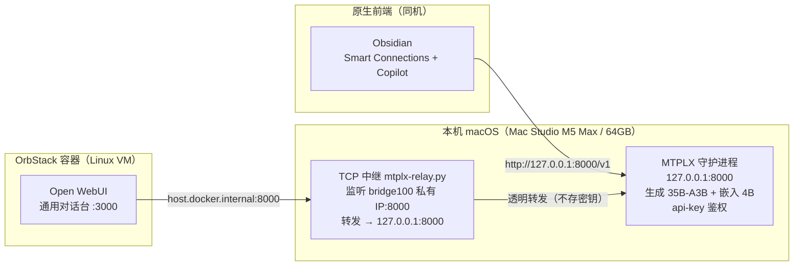

# MTPLX — Apple Silicon 本地 AI 实验室栈

> 一份本地优先、隐私优先的 Apple Silicon 推理栈文档。它把 **Qwen3.6-35B-A3B（MoE，生成）** 与 **Qwen3-Embedding-4B**（嵌入）同进程托管在 `mtplx` 运行时上，对外暴露 OpenAI 兼容接口，仅回环绑定并带 api-key 鉴权；两类前端接入——**OpenWebUI（OrbStack 容器）** 经 TCP 中继够到仅回环服务，**Obsidian（Smart Connections / Copilot，原生同机）** 直连回环地址。
>
> 本文档刻意对照参考仓库 [`qwen3.8-27b-apple-silicon-agent`](https://github.com/t64c6d7mc5-debug/qwen3.8-27b-apple-silicon-agent) 的结构编写，但记录的是**本工作区实际落地的方案**，而非该仓库的上游 `mlx-serve` + Qwen Code 方案。二者的差异见文末「与参考仓库的差异」。

---

## 参考配置（Reference configuration）

| 组件    | 参考设置                                                                                            |
| ----- | ----------------------------------------------------------------------------------------------- |
| 生成模型  | **当前**：`mlx-community/Qwen3.6-35B-A3B-4bit`（MoE，35B 总参/3B 激活，~20.4GB）<br/>**回滚保留**：`Youssofal/Qwen3.8-27B-MTPLX-Optimized-Quality`（28GB 仍缓存，未删） |
| 嵌入模型  | `mlx-community/Qwen3-Embedding-4B-4bit-DWQ`（向量维度 2560，自动识别）                                     |
| 运行时   | `mtplx`，运行于本机受管 Python 3.13 venv：`<HOME>/.workbuddy/binaries/python/envs/mtplx/bin/mtplx` |
| 客户端   | OpenWebUI（OrbStack 容器，`:3000`）+ Obsidian Smart Connections / Copilot（原生同机）                      |
| 接口    | OpenAI 兼容：`http://127.0.0.1:8000/v1`                                                            |
| 鉴权    | `Bearer` api-key，落盘于 `<MTPLX_STATE_DIR>/api-key`，权限 `600`（仅本机可读）                                         |
| 上下文窗口 | 模型配置锁死 **262144（256k）**（本栈未额外限定；满上下文 KV 上限≈17 GiB）                              |
| 绑定    | 生成/嵌入服务仅 `127.0.0.1`；容器接入经桥接私有 IP 的中继（见架构）                                                      |
| 模型来源  | Hugging Face 官方不可达时回退 `HF_ENDPOINT=https://hf-mirror.com`（同命名空间权重）                              |
| 参考机   | Mac Studio（Apple M5 Max，18 核，64GB 统一内存）                                                         |

> 本栈**仅包含配置与脚本，不包含模型权重、日志、凭证或应用源码**。权重需自行从 Hugging Face / 镜像源拉取，并保留在绝对路径下。

---

## 包含内容（What is included）

- **`mtplx-serve.sh`** — 单实例守护进程启动脚本（方案 C：全 MLX 原生栈）。生成 + 嵌入同进程托管，OpenAI 兼容接口，仅回环，api-key 落盘权限 `600`。回退只需删除本文件 + `rm -rf <MTPLX_STATE_DIR>/models/<模型目录>`。
- **`verify-mtplx.sh`** — 双模型全链路一键验收：探活与认证、`/v1/embeddings` 实测、`/v1/chat/completions` 生成实测。
- **`mtplx-relay.py`** — 纯 Python 标准库实现的 TCP 中继（无第三方依赖），让 OrbStack 容器经桥接私有 IP 够到仅回环的 MTPLX（推荐方案 E）。
- **`OpenWebUI-OrbStack部署命令.md`** — 通用 OpenWebUI（OrbStack）精确部署命令与防火墙方案。
- **`OpenWebUI容器访问MTPLX方案.md`** — 专解「容器如何够到仅回环 MTPLX」的中继方案与安全审计。
- **`个人AI实验室建设与部署方案.md`** — 总体架构、数据分级治理、量化效果评估与实施路线。
- 扩展文档：`第二大脑-*`、`PDF摄取方案与安全审计.md`、`图像与视频生成接入方案.md` 等（知识库与多模态能力的延伸，不在本栈核心推理链路内）。

---

## 快速开始（Quick start）

> 前置：确认 `mtplx` 已安装于本机受管 Python venv（路径见 `mtplx-serve.sh`）。权重需先拉取（官方不可达时走 `hf-mirror.com`，同一命名空间 `Youssofal/`、`mlx-community/`）。

1. **启动推理守护进程**（生成 + 嵌入同进程，仅回环，自动生成 api-key）：
   ```bash
   bash <DEPLOY_DIR>/mtplx-serve.sh
   ```
   > 该脚本以 `exec` 前台运行；亦可通过 launchd 常驻（见对应 plist）。
2. **双模型全链路验收**：
   ```bash
   bash <DEPLOY_DIR>/verify-mtplx.sh
   ```
   预期：探活 `HTTP 200`、嵌入向量维度 `2560`、生成接口返回一句话响应。
3. **原生前端（同机 Obsidian）直连**：在 Smart Connections / Copilot 中填 `http://127.0.0.1:8000/v1` 与 `<MTPLX_STATE_DIR>/api-key` 即可，**不受回环限制影响**。
4. **容器前端（OpenWebUI）接入**：按 `OpenWebUI容器访问MTPLX方案.md` 启动中继（`mtplx-relay.py`，绑 `bridge100` 私有 IP）并拉起 OpenWebUI 容器（`-p 127.0.0.1:3000:8080`）。UI 仅回环，不暴露公网。

---

## 当前部署状态（2026-11-03 快照）

> 以下为本地实际落地状态，非纸面方案。细节见 `OpenWebUI容器访问MTPLX方案.md` 第八节与 `MTPLX模型升级总结_27B到35B-A3B.md`。

- **生成模型**：`mlx-community/Qwen3.6-35B-A3B-4bit`（MoE，35B 总参 / 3B 激活，MLX 4bit ~20.4GB）。27B 权重 `Youssofal/Qwen3.8-27B-MTPLX-Optimized-Quality` 仍完整缓存于 `<MTPLX_STATE_DIR>/models/`（28GB），可随时回滚；但 64GB 机型两模型**不可同时常驻**（峰值合计 >64GB）。
- **引擎**：`mtplx` 2.12.2（基于 mlx-lm 0.31.3 / mlx 0.32.2），**已原生支持 `qwen3_5_moe` 架构（含 Gated-DeltaNet），无需升级**。⚠️ 网上 `21.9GB GGUF` 是 llama.cpp 格式，本 MLX 栈**不能直接加载**，必须改用 MLX 权重。
- **实测性能**：生成吞吐 **~113 tok/s**（含推理思考）；Swap 仅 ~642MB，无颠簸。
- **进程托管**：MTPLX 与中继当前为**手动 nohup 进程**，尚未接入 launchd。须在真实 Terminal 运行 `bash <DEPLOY_DIR>/enable-mtplx-persistence.sh` 一键接管常驻（含失败回退）。⚠️ `launchctl load` 在现代 macOS 已废弃（报 `Load failed: 5: Input/output error`），须用 `bootstrap` / `enable` / `bootout`。
- **前端（OpenWebUI）当前状态**：⚠️ **暂不可访问**——`OrbStack` 处于 Stopped，桥接 IP `<ORBSTACK_BRIDGE_IP>` 消失，中继套接字 CLOSED，OWUI 容器未起。模型 API 自身正常（`:8000` 在服）。恢复仅需 `orbctl start` + 重启中继（见 `OpenWebUI容器访问MTPLX方案.md` 4.3 / 第七节）。
- **知识库/代码仓库**：本地部署文档与脱敏版已推送至 `github.com/aiedwardai/AstraX`（原 `AI-Lab`，远端已更名，旧地址仍重定向）。

---

## 架构（Architecture）

本栈四类本地组件，全部经模板与环境变量配置，而非写死机器专属路径：



### 运行时边界（Runtime boundary）

`mtplx` 独占推理。它以 `exec` 前台托管，生成与嵌入同进程；模型目录须为**绝对路径**。api-key 在首次运行时由 `openssl rand -hex 16` 生成并写入 `<MTPLX_STATE_DIR>/api-key`（`chmod 600`）。

### 客户端边界（Client boundary）

两类客户端均使用 OpenAI 兼容的回环端点：

- **原生同机**（Obsidian）：直接 `127.0.0.1:8000`，无网络开销；
- **容器内**（OpenWebUI）：经 `host.docker.internal`（OrbStack 解析到虚拟路由 IP `0.250.250.254`）→ 中继 → 回环。

### 中继边界（Relay boundary）

`mtplx-relay.py` 是纯 `socket` / `threading` 标准库的透明 TCP 转发。它**只绑 OrbStack 桥接的宿主侧真实 IP（`bridge100` 接口，如 `<ORBSTACK_BRIDGE_IP>`）**，**不在 `en0` / Wi-Fi / 局域网监听**，不落盘任何密钥，仅做字节搬运。MTPLX 末端的 api-key 鉴权在转发链末端仍然生效，即使中继被绕过也无可乘之机。

### 文件系统边界（Filesystem boundary）

脚本引用 `$HOME` 与环境变量，不假设特定账户名、模型缓存布局或日志位置。凭证、模型权重、日志均不进仓库（见安全章节）。

---

## 性能说明（Performance interpretation）

> 以下为**规划预估**（来源：个人 AI 实验室方案 §5.1），非本机实测基准，且本栈未启用 Native MTP（见差异章节），不可与参考仓库的 MTP 提速数字直接比较。

| 模型规格      |              量化精度 |       预估生成吞吐 | 首字延迟 (TTFT) |   内存开销 | 说明                        |
| --------- | ----------------: | -----------: | ----------: | -----: | ------------------------- |
| 27B（回滚保留） | Optimized-Quality | ~18–25 tok/s |   0.8–1.5 s | ~18 GB | 原主力；权重仍缓存，可切回，但 64GB 机型与 35B-A3B 不可同时常驻 |
| 35B-A3B（当前主力） | MLX 4bit（MoE） | **实测 ~113 tok/s** |   ~1 s | ~20.4 GB | 35B 总参仅激活 3B，MoE 低激活使吞吐高于 27B；原生支持看图（`supports_vision`） |

**实测注意项（已验证）**：当前主力 **35B-A3B** 与保留的 27B 均为 **Qwen3（带 reasoning 思考过程）**，思考会占用 token。若 `max_tokens` 过小（如 64），`content` 可能被思考占满而显空——给足 `max_tokens`（如 2048）即可正常出字。35B-A3B 实测吞吐 **~113 tok/s**（远超 27B 的 18–25 tok/s），印证 MoE 仅激活 3B 在 MLX 上的优势；`/v1/models` 显示其 `supports_vision: true`（原生支持看图，无需单独 mmproj）。

资源边界：实测引擎预算 **48.0 GiB**（64G Mac 自动规划），其中 27B 权重固定占 **27.9 GiB**，剩余约 20 GiB 供 live KV + session bank；256k 上下文下单会话 KV 上限≈17 GiB。macOS 自身约 8GB、Docker/开发环境约 8GB，余量远小于纸面预估的 30GB，**长上下文并发易顶满 48G 触发 `overloaded`（见故障排查）**。本机适合单人、低并发（1–2 任务）；高并发场景应走云端协同路由（P2）。

---

## 已实测验证（Verified workloads）

> 以下均为 **2026-10-15 实测通过**，非纸面方案（来源：`OpenWebUI容器访问MTPLX方案.md` §六）。

- Docker / OrbStack 在线，`docker info` 显示 context `orbstack`、server 29.8.2。
- 桥接 IP 机制修正：容器内 `host.docker.internal` 解析到**虚拟路由 IP `0.250.250.254`**（不可绑定）；中继须绑宿主 **`bridge100` 真实 IP**（实测 `<ORBSTACK_BRIDGE_IP>`）。
- 中继双验证通过：①本地 `127.0.0.1:18000 → 127.0.0.1:8000` 透传真实对话成功；②桥接绑定后容器内 `curl http://host.docker.internal:8000/v1/models` 返回 **HTTP 200**。
- OpenWebUI 0.12.2 拉起，`--restart always`，UI 仅绑 `127.0.0.1:3000`。
- 管理员注册真实路径：`POST /api/v1/auths/signup`（**不是** `/api/auth/register`），首用户自动为 admin 并关闭公开注册。
- 模型识别：`GET /api/models` 当前返回 `qwen3.6-35b-a3b-4bit`（2026-10-29 由 27B 切换）；端到端对话正常返回。

---

## 安全与隐私（Security and privacy）

### 本地优先边界（Local-first boundary）

- 生成/嵌入服务默认仅绑 `127.0.0.1`。容器接入采用**方案 E（中继）**，MTPLX 保持 `127.0.0.1` 零改动；唯一新增监听是绑在 OrbStack 私有桥接 IP 上的中继，**不暴露到 `en0` / Wi-Fi / 局域网 / 公网**。
- 端口一律绑 `127.0.0.1`（UI 与 MTPLX），**绝不 `0.0.0.0` 暴露公网**；远程访问留到后续阶段用 Tailscale，不在本步开放。

### 必须不提交的内容（What must not be committed）

- api-key、token、密码、cookie、浏览器数据或私有配置；
- 绝对账户路径或机器标识；
- 模型权重、Hugging Face 缓存、运行时状态、日志、生成产物或依赖目录；
- 私有应用源码或数据。

`mtplx-serve.sh` 已注明：回退只需删除脚本 + `rm -rf <MTPLX_STATE_DIR>/models/<模型目录>`，不残留系统改动。

### 配置指引（Configuration guidance）

- 使用 `$HOME` 与环境变量承载机器本地值。
- 中继不落盘密钥；其绑定 IP 优先读环境变量 `MTPLX_RELAY_BIND_IP`，缺省回退 `0.0.0.0` 并告警（此时需配合方案 A 的 pf 或手动收紧）。
- `WEBUI_SECRET_KEY` 固定保存；`<MTPLX_STATE_DIR>/api-key` 不提交仓库。

### 发布/交接审查（Release review）

提交前人工扫描工作树，排查个人路径、凭证与无关源码；`.gitignore` 仅是安全网，不能替代 `git status` 与暂存清单的逐条核对。

---

## 故障排查（Troubleshooting）

| 现象                                      | 原因                                                           | 处理                                                                                                                                 |
| --------------------------------------- | ------------------------------------------------------------ | ---------------------------------------------------------------------------------------------------------------------------------- |
| 容器连不上 MTPLX                             | 中继未常驻（方案 E）或 `bridge100` IP 变化                               | 确认中继经 launchd 常驻：`launchctl bootstrap gui/$UID <LAUNCH_AGENTS_DIR>/com.user.mtplx-relay.plist` + `launchctl enable gui/$UID/com.user.mtplx-relay`；`ifconfig bridge100` 取新 IP 回填 `MTPLX_RELAY_BIND_IP` 后 `bootout` 再 `bootstrap` |
| 中继起不来，`Cannot assign requested address` | 误绑 `host.docker.internal` 解析到的 `0.250.250.254`（魔法地址，宿主接口不存在） | 改绑 `bridge100` 真实 IP（如 `<ORBSTACK_BRIDGE_IP>`）                                                                                            |
| 对话内容空白                                  | Qwen3 思考 token 占满 `max_tokens`                               | 调大 `max_tokens`（如 ≥256）                                                                                                            |
| `401 / 403`                             | api-key 不匹配                                                  | 确认客户端填的是 `<MTPLX_STATE_DIR>/api-key` 当前内容                                                                                                   |
| MTPLX 端口被占用                             | 已有实例在跑                                                       | 本栈启动脚本为前台 `exec`，不幂等；先停旧实例或复用现有 `127.0.0.1:8000`                                                                                   |
| 请求被拒 `overloaded` / insufficient memory | 引擎 48G 预算被权重(27.9G)+live KV 顶满；超长 prompt(≈11万+token)或并发长会话触发 | 请求 `retryable`，等当前请求排空后重试即可；降并发（同时只跑 1 个长请求）；OpenWebUI 把 Context Window Size 从 256k 降到 32k–64k；`mtplx-serve.sh` 已加 `MTPLX_SESSION_BANK_*` 护栏 |

---

## 回退（Rollback）

```bash
# 推理栈：删除启动脚本 + 清理权重即可彻底清理
rm -f <DEPLOY_DIR>/mtplx-serve.sh
rm -rf <MTPLX_STATE_DIR>/models/<模型目录>

# 中继：卸载 launchd 常驻，可临时以 nohup 兜底
launchctl bootout gui/$(id -u)/com.user.mtplx-relay
nohup python3 "<DEPLOY_DIR>/mtplx-relay.py" \
  > <MTPLX_STATE_DIR>/logs/relay.out.log 2>&1 &
```

---

## 文档索引（Documentation）

- [OpenWebUI-OrbStack部署命令.md](./OpenWebUI-OrbStack部署命令.md) — 通用 OpenWebUI 部署与防火墙方案 A
- [OpenWebUI容器访问MTPLX方案.md](./OpenWebUI容器访问MTPLX方案.md) — 容器够到仅回环 MTPLX 的中继方案 E 与安全审计
- [个人AI实验室建设与部署方案.md](./个人AI实验室建设与部署方案.md) — 总体架构、数据治理、量化评估
- [AI实验室部署目标架构图.html](./AI实验室部署目标架构图.html) — 目标态可视化
- [rule.md](./rule.md) — 项目规则（先架构图→再安全审计→后编码，Google 规范 + 中文注释）

---

## 与参考仓库的差异（Differences vs. reference repo）

| 维度         | 本栈（MTPLX）                                       | 参考仓库（mlx-serve + Qwen Code）               |
| ---------- | ----------------------------------------------- | ----------------------------------------- |
| 服务程序       | 自研 `mtplx`（venv）                                | 上游 `mlx-serve` (ddalcu)                   |
| 生成模型       | `mlx-community/Qwen3.6-35B-A3B-4bit`（2026-10-29 切换；27B 权重仍缓存可回滚） | `ddalcu/Qwen3.8-27B-MLX-Serve-8bit`       |
| 嵌入模型       | 同进程 `Qwen3-Embedding-4B`                        | 未内置                                       |
| 客户端        | OpenWebUI（容器）+ Obsidian（原生）                     | Qwen Code（CLI 编码 Agent，Coding-Lean 画像）    |
| 容器接入       | TCP 中继（方案 E，MTPLX 零改动保持回环）                      | 不适用（同机 CLI）                               |
| 端口         | `127.0.0.1:8000` + api-key                      | `11235` 推理 / `11236` 监控                   |
| Native MTP | **当前未启用**（需核查 mtplx 是否支持 `--mtp/--pld`）         | 已启用（depth 8，短码基准 ~3.5× 提速）                |
| 监控器        | 无（可平移仓库的回环只读 `monitor.py`，需改正则）                 | 内置 `monitor.py`（stdlib，只读 tail 日志）        |
| 工具画像       | 不适用                                             | Coding-Lean：工具 schema 18.2K→5.3K token/请求 |

> 本栈可直接借鉴参考仓库的三项能力：① **Coding-Lean 画像**改 `baseUrl` 指向 `:8000/v1` 即可复用（注意 `OPENAI_API_KEY` 填真实 `<MTPLX_STATE_DIR>/api-key`）；② **回环只读监控**框架可平移，但日志正则需匹配 MTPLX 格式；③ **Native MTP 提速**需先确认 `mtplx` 是否支持，否则须另起上游 `mlx-serve` 实例。


---

## 许可（License）

内部部署文档，供个人 AI 实验室使用。不含任何第三方模型权重、凭证或源码；引用上游项目时遵循其各自许可（参考仓库为 MIT）。
