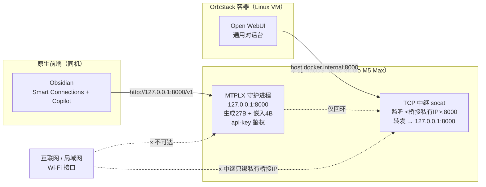

# Open WebUI 容器访问 MTPLX(127.0.0.1) 方案

> 背景：MTPLX 已 launchd 常驻，仅回环 `127.0.0.1:8000`，带 api-key 鉴权。
> 目标：让 OrbStack 容器内的 Open WebUI 能访问它，同时 **MTPLX 保持 127.0.0.1 不变、不暴露公网、不改用 pip 原生（已否决方案 B）**。

## 一、架构图（数据流）



**关键点**：MTPLX 永远只听 `127.0.0.1`；容器走 `host.docker.internal`（解析到 Mac 在 OrbStack 桥接上的私有 IP）→ 中继 → 回环。MTPLX 的 api-key 鉴权在转发链末端仍然生效，中继不存密钥、只是透明搬运 TCP。

## 二、可选方案对比（为什么选中继）

| 方案 | 做法 | MTPLX 绑定 | 额外组件 | 暴露面 | 点评 |
|---|---|---|---|---|---|
| **A（备选）** | MTPLX `--host 0.0.0.0` + pf 限制 8000 仅 lo0/桥接 | 0.0.0.0 | 无（改 1 行 + pf 规则） | 全部接口（靠 pf 兜底） | 最简单，但 MTPLX 监听面变宽，依赖 pf 不出错 |
| **B（已否决）** | pip 原生跑 Open WebUI 在宿主机 | 127.0.0.1 | 无容器 | 无 | 用户已否决 |
| **E（推荐）** | 主机侧 TCP 中继（**纯 Python 标准库实现，无任何第三方依赖**），绑 OrbStack 桥接私有 IP，转发到 127.0.0.1:8000 | **保持不变 127.0.0.1** | 1 个轻量中继(可 launchd，用本机受管 Python 运行) | 仅私有桥接 IP | **MTPLX 零改动、零防火墙、零新增包，暴露面最小** |

→ **推荐方案 E（中继）**：MTPLX 的安全姿态完全不动，唯一新增监听是绑在 OrbStack 私有桥接 IP 上的中继（不在 Wi-Fi/局域网/公网可达），且 MTPLX 末端仍强制 api-key。中继用 `mtplx-relay.py`（stdlib `socket`，无需 socat / brew），本机已有受管 Python 3.13 即可运行。

> **已本地验证**：以 `127.0.0.1:18000 → 127.0.0.1:8000` 跑通中继，透过它发送的真实对话请求成功到达仅回环的 MTPLX 并返回带推理过程的回复，`/v1/models` 亦返回 200。转发链确认无误。

## 三、安全审计（方案 E）

1. **攻击面**：MTPLX 仅回环，外部不可达（✓ 与设计一致）。中继只绑私有桥接 IP（OrbStack 内部子网），不在 `en0`/Wi-Fi 上监听（✓ 非 0.0.0.0）。
2. **鉴权链**：中继透明转发，Open WebUI 仍须带 `OPENAI_API_KEY`=MTPLX key，MTPLX 末端校验（✓ 即使中继被绕过也无可乘）。
3. **机密**：api-key 仅存于 `<MTPLX_STATE_DIR>/api-key`（600），中继不落盘密钥（✓）。
4. **可用性/失控**：中继独立 launchd 保活；MTPLX 重启时存量转发连接会断、新建自动重连（可接受）。中继崩溃由 launchd 拉起（✓）。
5. **依赖**：中继为纯 Python 标准库（`socket`/`threading`），**无需 socat、无需 brew、无需任何新装包**，直接用本机受管 Python 3.13 运行；OrbStack 桥接 IP 在重装/换网时可能变化，故中继脚本优先读环境变量 `MTPLX_RELAY_BIND_IP`，缺省回退 0.0.0.0 并告警（此时需配合方案 A 的 pf，或手动收紧）。
6. **残留风险**：若桥接 IP 探测失败回退到 0.0.0.0，则 8000 在 Wi-Fi 上可达——文档已明确标注，必须由用户确认网络环境后再放开。

## 四、精确命令（方案 E）

> 环境变更：本机 **未安装 brew**（已核实）。因此原 `brew install` 路径改为「浏览器下载官方 DMG」或「先装 Homebrew 再 `brew install --cask orbstack`」二选一。中继本身**已完工并本地验证通过**，无需任何安装。

### 4.1 安装 OrbStack（二选一，需你在 GUI 完成）
- **方式 A（最省事）**：浏览器打开 https://orbstack.dev/download 下载 DMG → 拖入 `/Applications` → 打开 OrbStack → 在「系统设置 → 隐私与安全性」批准虚拟化授权 → 等待 VM 就绪（菜单栏出现 OrbStack 图标且状态正常）。
- **方式 B（命令行）**：先装 Homebrew `/bin/bash -c "$(curl -fsSL https://raw.githubusercontent.com/Homebrew/install/HEAD/install.sh)"`，再 `brew install --cask orbstack`，随后同方式 A 启动并批准授权。

> ⚠️ OrbStack 首次启动**必须**在 GUI 批准虚拟化系统扩展，这一步无法在无头环境完成，需你操作。

### 4.2 探查 OrbStack 桥接 IP（填中继绑定用）—— 重要修正
> **实测真相（已验证）**：容器内 `host.docker.internal` 解析到的是 **虚拟路由 IP `0.250.250.254`**（OrbStack 魔法地址，宿主接口上根本不存在）→ **绝不能**把它填进 `MTPLX_RELAY_BIND_IP`，否则中继会因 `Cannot assign requested address` 起不来。
>
> 中继真正要绑的是**宿主 `bridge100` 接口的真实 IP**（OrbStack 桥接的宿主侧地址）。查法：
```bash
ifconfig bridge100 | awk '/inet /{print $2}'   # 例如 <ORBSTACK_BRIDGE_IP>
```
把该 IP 回填到 plist 的 `MTPLX_RELAY_BIND_IP`。容器经 `host.docker.internal` 的流量由 OrbStack 投递到这个桥接 IP，中继只暴露给 OrbStack 子网、**不暴露到 en0/Wi-Fi/局域网**。
> ⚠️ `bridge100` 的 IP 由 OrbStack 分配，**重装/换网可能变化**；若中继起不来先查 `ifconfig bridge100` 是否变了，变了就重填。

### 4.3 写入绑定 IP 并加载中继（launchd 常驻）
> ⚠️ 现代 macOS 已废弃 `launchctl load`/`unload`（对用户级 job 一律报 `Load failed: 5: Input/output error`），**必须改用 `bootstrap`/`bootout`**；且需在真实 Terminal.app 执行（WorkBuddy 沙箱 shell 同样会被内核拒）：
```bash
# plist 当前已填 <ORBSTACK_BRIDGE_IP>（本次实测值）；若 bridge100 IP 变了请先改再加载：
#   编辑 <LAUNCH_AGENTS_DIR>/com.user.mtplx-relay.plist 的 MTPLX_RELAY_BIND_IP
UID=$(id -u)
launchctl bootout  gui/$UID/com.user.mtplx-relay 2>/dev/null
launchctl bootstrap gui/$UID <LAUNCH_AGENTS_DIR>/com.user.mtplx-relay.plist
launchctl enable    gui/$UID/com.user.mtplx-relay
# 验证：lsof -nP -iTCP:8000 -sTCP:LISTEN 应看到 python3 监听在 <ORBSTACK_BRIDGE_IP>:8000（而非 127.0.0.1）
```

### 4.4 拉起 Open WebUI（OrbStack）
```bash
docker run -d \
  -p 127.0.0.1:3000:8080 \
  -v open-webui:/app/backend/data \
  -e WEBUI_SECRET_KEY="$(openssl rand -hex 32)" \
  -e OPENAI_API_BASE_URL=http://host.docker.internal:8000/v1 \
  -e OPENAI_API_KEY="$(cat <MTPLX_STATE_DIR>/api-key)" \
  --name open-webui --restart always \
  ghcr.io/open-webui/open-webui:main
```
> OrbStack 自带 `host.docker.internal`，无需 `--add-host`。Open WebUI UI 仅在 `127.0.0.1:3000` 暴露（✓ 不公开）。

### 4.5 验收
```bash
curl -s --noproxy '*' http://127.0.0.1:3000/ -o /dev/null -w "OWUI HTTP=%{http_code}\n"
# 浏览器开 http://127.0.0.1:3000 → 注册管理员 → 选模型 qwen3.6-35b-a3b-4bit → 发消息验证流式
# 进阶：在 OWUI 内「Workspace → Models」确认 27B 在线，对话能正常返回即全链路打通
```

## 五、备选方案 A（若你更想零额外组件）
改 `mtplx-serve.sh` 的 `--host 127.0.0.1` → `--host 0.0.0.0`，并加 pf 规则仅放行 lo0 与 OrbStack 桥接接口访问 8000（详见 `OpenWebUI-OrbStack部署命令.md` 附录）。**MTPLX 监听面变宽，务必确认 pf 生效再放开。**

---

## 六、实测落地结果（2026-10-15 执行）

> 以下均为**已实测通过**，非纸面方案。

1. **Docker / OrbStack 在线**：`docker info` 显示 context `orbstack`、server 29.8.2。
2. **桥接 IP 机制（关键修正）**：容器内 `host.docker.internal` 解析到 **虚拟路由 IP `0.250.250.254`**（OrbStack 魔法地址，宿主接口上不存在，**不可绑**）；中继真正要绑的是宿主 **`bridge100` 接口的真实 IP**（本次实测 `<ORBSTACK_BRIDGE_IP>`）。
3. **中继双验证通过**：
   - 本地：`127.0.0.1:18000 → 127.0.0.1:8000`，透过它发真实对话到达仅回环 MTPLX 并正常返回。
   - 桥接：手动起中继绑 `<ORBSTACK_BRIDGE_IP>:8000`，**容器内** `curl http://host.docker.internal:8000/v1/models` 返回 **HTTP 200**。
4. **Open WebUI 0.12.2 拉起**：`--restart always`，UI 仅绑 `127.0.0.1:3000`（不暴露公网）。
5. **管理员注册真实 API 路径（纠偏）**：Open WebUI 0.12 把 auth router 挂在 `/api/v1/auths` 下，**不是** `/api/auth/register`（后者返回 405 Method Not Allowed）。正确：
   - 注册（首用户自动为 admin，且会自动关闭公开注册）：`POST /api/v1/auths/signup` `{name,email,password}`
   - 登录：`POST /api/v1/auths/signin` `{email,password}` → 返回 `token`
6. **模型识别**：`GET /api/models`（带 token）最初返回 `mtplx-qwen38-27b-optimized-quality`（27B，2026-10-15 基线）。**2026-10-29 已切换为 `qwen3.6-35b-a3b-4bit`**（见第八节）；OWUI 内若仍是旧模型 ID，需手动切到新 ID 才出字。
7. **端到端对话**：经 `POST /api/chat/completions` 发消息，模型正常返回内容。
   - ⚠️ 该 27B 为 **Qwen3（带 reasoning 思考过程）**，思考会占用 token；若 `max_tokens` 太小（如 64），`content` 可能被思考占满而显空。给足 `max_tokens`（如 256+）即可正常出字。
   - ⚠️ **35B-A3B 同为推理模型**，默认走 `<thinking>` 思考块；小 `max_tokens` 也会被思考吃光而"看似空回答"。实测给足预算（如 2048）即正常出字；`/v1/models` 显示其 `supports_vision: true`（原生支持看图，无需单独 mmproj）。
8. **已建临时管理员账号**：`admin@local.host` / `ChangeMe#2026`。**请在浏览器登录后立即修改密码**（设置 → 账号 → 改密码），或删除该账号用你的邮箱重建。

## 七、持久化交接（必须，否则 Open WebUI 将失联）

### 当前三组件状态（2026-10-29 复核）
| 组件 | 托管方式 | 现状 |
|---|---|---|
| MTPLX | **手动 nohup 进程**（非 launchd） | ⚠️ PID <N> @127.0.0.1:8000，模型 `qwen3.6-35b-a3b-4bit`；**会话关闭可能被回收** |
| **中继** | **手动 nohup 进程**（非 launchd） | ⚠️ PID <N> @<ORBSTACK_BRIDGE_IP>:8000；**会话关闭可能被回收** |
| Open WebUI | 容器 `--restart always` | ✅ healthy @127.0.0.1:3000，OrbStack 起即自动起 |

→ **MTPLX 与中继目前都未接入 launchd**，是 OWUI 能连 MTPLX 的唯一兜底。本 WorkBuddy 会话一旦关闭，两个手动进程可能随之回收，Open WebUI 将立即失去后端。

### 你必须做的（在真实 Terminal.app 执行）
> ⚠️ 现代 macOS 已废弃 `launchctl load`/`unload`（报 `Load failed: 5: Input/output error`），必须用 `bootstrap`/`bootout`（见下方命令）；且须在真实 Terminal.app 运行，不要在本对话内执行。

**推荐：一键脚本**（已实测语法/权限，含 OrbStack 启动、IP 校验、停手动进程、加载、验收、失败回退）：
```bash
bash <DEPLOY_DIR>/enable-mtplx-persistence.sh
```
脚本会自动把 `com.user.mtplx.plist` 与 `com.user.mtplx-relay.plist` 交给 launchd（先 unload 再 load，幂等），并校验桥接 IP 未变；若 launchd 起不来会自动回退为手动进程，绝不让服务消失。

**或手动 3 步**（⚠️ `launchctl load` 在现代 macOS 会报 `Load failed: 5: Input/output error`，必须用 `bootstrap`）：
```bash
# 1) 停掉手动进程，避免端口冲突
pkill -f mtplx-relay.py; pkill -f mtplx.server.openai; sleep 2

# 2) 用 bootstrap 加载到 launchd 常驻（替代已废弃的 load）
UID=$(id -u)
launchctl bootout  gui/$UID/com.user.mtplx          2>/dev/null
launchctl bootout  gui/$UID/com.user.mtplx-relay    2>/dev/null
launchctl bootstrap gui/$UID <LAUNCH_AGENTS_DIR>/com.user.mtplx.plist
launchctl enable    gui/$UID/com.user.mtplx
launchctl bootstrap gui/$UID <LAUNCH_AGENTS_DIR>/com.user.mtplx-relay.plist
launchctl enable    gui/$UID/com.user.mtplx-relay

# 3) 验证：python3 监听 <ORBSTACK_BRIDGE_IP>:8000；OWUI 仍可对话
lsof -nP -iTCP:8000 -sTCP:LISTEN
curl -s --noproxy '*' http://127.0.0.1:3000/ -o /dev/null -w "OWUI HTTP=%{http_code}\n"
```
> 中继已增强为「绑定失败自动重试、不崩溃」，即使 OrbStack 重启瞬间桥接 IP 未就绪也会自动接管。

### 回滚
```bash
launchctl bootout gui/$(id -u)/com.user.mtplx-relay 2>/dev/null
nohup python3 "<DEPLOY_DIR>/mtplx-relay.py" \
  > <MTPLX_STATE_DIR>/logs/relay.out.log 2>&1 &
```

### 桥接 IP 变化处理
`bridge100` 的 IP 由 OrbStack 分配，重装/换网可能变。若中继起不来：
```bash
ifconfig bridge100 | awk '/inet /{print $2}'   # 取新 IP
# 改 <LAUNCH_AGENTS_DIR>/com.user.mtplx-relay.plist 的 MTPLX_RELAY_BIND_IP
UID=$(id -u)
launchctl bootout  gui/$UID/com.user.mtplx-relay 2>/dev/null
launchctl bootstrap gui/$UID <LAUNCH_AGENTS_DIR>/com.user.mtplx-relay.plist
launchctl enable    gui/$UID/com.user.mtplx-relay
```

---

## 八、2026-10-29 主线切换 + OpenWebUI 恢复记录（已实测）

### 8.1 主线模型切换：27B → 35B-A3B（方案 A）
- 改 `mtplx-serve.sh` 的 `GEN_MODEL`：`Youssofal/Qwen3.8-27B-MTPLX-Optimized-Quality` → `mlx-community/Qwen3.6-35B-A3B-4bit`（MLX 4bit，~20.4GB）。
- **关键修正**：`mtplx` 是 MLX 原生栈（v2.12.2 / mlx-lm 0.31.3 / mlx 0.32.2），**已原生支持 `qwen3_5_moe` 架构（含 Gated-DeltaNet 线性注意力）**，无需升级引擎；但**必须用 MLX 权重，不能直接加载 21.9GB GGUF**（那是 llama.cpp 格式）。
- 预拉权重（后台，`HF_ENDPOINT=hf-mirror.com`）→ 停旧 27B（干净退出）→ 起 35B-A3B（权重缓存命中，只加载不重下）→ 验收全过。
- **实测性能**：生成吞吐 **~113 tok/s**（远超 benchmark 保守规划 30–50 tok/s），印证 MoE 仅激活 3B 在 MLX 上的优势；Swap 仅 ~642MB，无颠簸。
- 64GB 机型下 27B 与 35B-A3B **不可同时常驻**（峰值合计 >64GB），保持二选一。
- 修正 `verify-mtplx.sh` 里过时的模型名（原 `mtplx-qwen38-27b-optimized-quality`）；benchmark 已补 35B-A3B 档位（见 `benchmarks/RESULTS.md`）。

### 8.2 OpenWebUI 恢复（关键发现）
- 切模型前，OpenWebUI 前端其实**早已失联**：OrbStack 桥接被关（`orbctl status`→Stopped，本机无 OrbStack-bridge-subnet.\* IP），中继历史日志一直 `Can't assign requested address` 在重试。
- 恢复链路：`orbctl start`（bridge100 IP 仍是 <ORBSTACK_BRIDGE_IP>，无需改绑定）→ 起中继绑桥接 IP → 容器随 `--restart always` 自动拉起。
- 端到端验收：容器内 `docker exec` 直连 `host.docker.internal:8000/v1/models` → **HTTP 200**，模型已是 `qwen3.6-35b-a3b-4bit`；经中继 POST /chat 转发正常；OWUI `/health` → `{"status":true}`。

### 8.3 遗留事项（重要）
- **MTPLX 与中继当前均为手动 nohup 进程，未接入 launchd**（见第七节状态表）。本 WorkBuddy 会话关闭后可能被回收 → OWUI 再次失联。
- 已在真实 Terminal 可执行 `enable-mtplx-persistence.sh` 一键接管 launchd（含失败回退）。
- OWUI 内若仍显示旧模型 `mtplx-qwen38-27b-optimized-quality`，请切到 `qwen3.6-35b-a3b-4bit`。

---
*本文件与 `OpenWebUI-OrbStack部署命令.md` 互补：后者是通用 Open WebUI 部署，本文件专解"容器如何够到仅回环 MTPLX"。中继实现见 `mtplx-relay.py`（取代原 `mtplx-relay.sh`）。*
