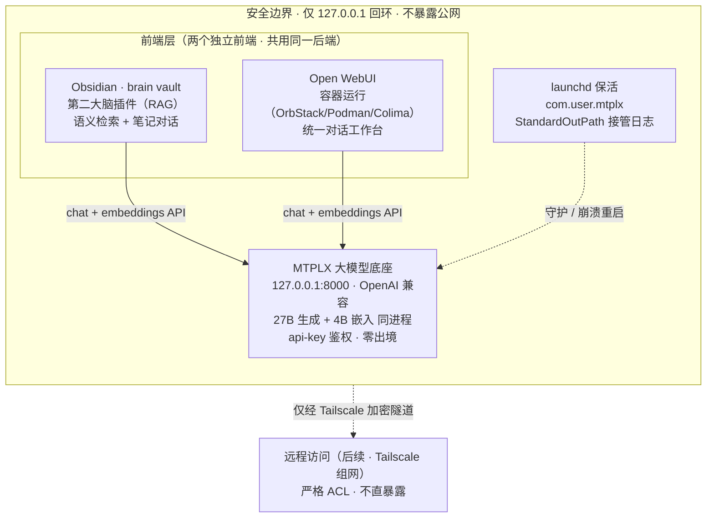

# AI 实验室部署设计与安全审计（第二大脑 + Open WebUI on MTPLX）

> 设计依据：本地 `个人AI实验室建设与部署方案.md`、ChatGPT 共享对话「设计AI实验室架构」、以及本机已验证的 Phase 0–2 成果（MTPLX 单实例托管 27B 生成 + 4B 嵌入，OpenAI 兼容，仅回环）。
> 本文遵循项目公约：**先架构图 → 再安全审计 → 后编码**。本文件为前两步产物；第三步（launchd plist 等）在其后。

---

## 一、目标架构图（组件 / 数据流）

**图例与职责说明**
- **实线**＝数据流（前端 → MTPLX 本地推理 → 返回；笔记内容在本地完成嵌入与检索，**不出本机**）。
- **虚线**＝安全运维贯穿（持久化保活、远程访问须经加密隧道）。
- **一个能力一个主负责人**：模型推理只有一个入口 `MTPLX`；Obsidian 与第二大脑负责"知识/RAG"，Open WebUI 负责"对话工作台"，互不重叠，无需额外 LiteLLM 路由层。
- **现状修正**：ChatGPT 方案中"4B 轻量聊天模型"在本机并不存在——4B 是 **Embedding 模型**（供第二大脑 RAG 用），聊天只有 27B 一个模型。

---

## 二、安全审计（部署前必过）

按风险点逐项评估：身份鉴权、访问控制、输入校验、敏感数据边界、第三方依赖、容器安全、持久化安全。

### 2.1 身份鉴权
- **现状**：MTPLX 已启用 `--api-key`，密钥落盘 `<MTPLX_STATE_DIR>/api-key`（权限 `600`，仅本机可读）。✅
- **风险**：Obsidian 插件与 Open WebUI 均需配置同一 key；若前端以"明文写配置文件"或"暴露在网页端"方式存 key，存在泄露面。
- **措施**：key 仅从 `<MTPLX_STATE_DIR>/api-key` 读取，不进任何 plist / 容器环境变量明文；前端配置文件权限收紧为 `600`。

### 2.2 访问控制
- **现状**：MTPLX `--host 127.0.0.1`（仅回环）；macOS 防火墙开启。✅
- **风险（高危）**：Open WebUI 容器若把端口映射到 `0.0.0.0` 或把宿主机端口发布到局域网，会直接暴露模型服务与 key。
- **措施**：容器仅映射 `127.0.0.1:PORT:8080`；Obsidian 仅连 `127.0.0.1:8000`；远程访问一律走 Tailscale，**绝不**把 8000 / Open WebUI 端口直接开放到公网或 `0.0.0.0`。

### 2.3 输入校验 / 提示注入
- **风险（中危）**：第二大脑会把 `brain` vault 的笔记内容作为上下文喂给模型。若笔记中含"指令式文本"（粘贴的网页/邮件/文档），可能触发**提示注入**，诱使模型执行非预期动作或外泄笔记。
- **措施**：RAG 上下文与系统指令严格分离；第二大脑只做"检索+总结+问答"，**不授予**写文件/执行命令/调用外部 API 的权限；人工审核闭环前不开放不可逆操作（与 ChatGPT 方案原则一致）。

### 2.4 敏感数据边界
- **现状**：本地模型不联网，笔记与对话零出境。✅
- **风险**：若 Open WebUI 同时挂了云端模型，敏感笔记可能被发往第三方；`brain` vault 可能含健康/财务/企业文件。
- **措施**：默认只用本地 27B；云端模型按需单独配置且明确标注；健康/财务/企业敏感资料建议**分 vault 或分目录**并单独设置访问权限。

### 2.5 第三方依赖安全
- **HF 镜像**：当前 `HF_ENDPOINT=https://hf-mirror.com`（官方源不可达时的绕行）。权重仍来自官方命名空间（`Youssofal/`、`mlx-community/`），**供应链完整性不变**；官方源恢复后删除该行即回归。需持续关注镜像站可用性。
- **容器镜像**：Open WebUI 必须用**官方镜像**并校验 digest（`ghcr.io/open-webui/open-webui:main` 的 arm64 版本），不从不明第三方构建。
- **Python 包**：在隔离 venv 内安装，不污染系统环境。

### 2.6 容器安全（Open WebUI）
- 以**非 root** 运行容器；限制内存（64GB 大部分须留给模型，容器内存上限要设小）；`brain` vault 以**只读**挂载给任何需要它的容器；不挂载 `<MTPLX_STATE_DIR>/api-key` 之外的敏感目录。

### 2.7 持久化安全（launchd）
- plist 权限 `644` 且**不含密钥明文**（key 由 `mtplx-serve.sh` 运行时从文件读取）。
- 日志：`request-log-8000.jsonl` 已存在且可能含请求内容，权限收紧为 `600` 并做轮转；launchd 用 `StandardOutPath/StandardErrorPath` 接管，不再用 `| tee`。
- `KeepAlive` 保活，但首次接入需先停掉当前"会话子进程"版的 MTPLX，避免**端口 8000 冲突导致启动失败 + 重启风暴**。

### 审计结论
- 总体风险**可控**，核心面（回环绑定、key 600、本地零出境）已具备；**最需盯防**的是容器端口误映射 `0.0.0.0` 与提示注入。
- 放行条件：容器仅 `127.0.0.1` 映射 + 第二大脑不授予写/执行权限 + plist 不含明文 key。满足后可进入编码阶段。
