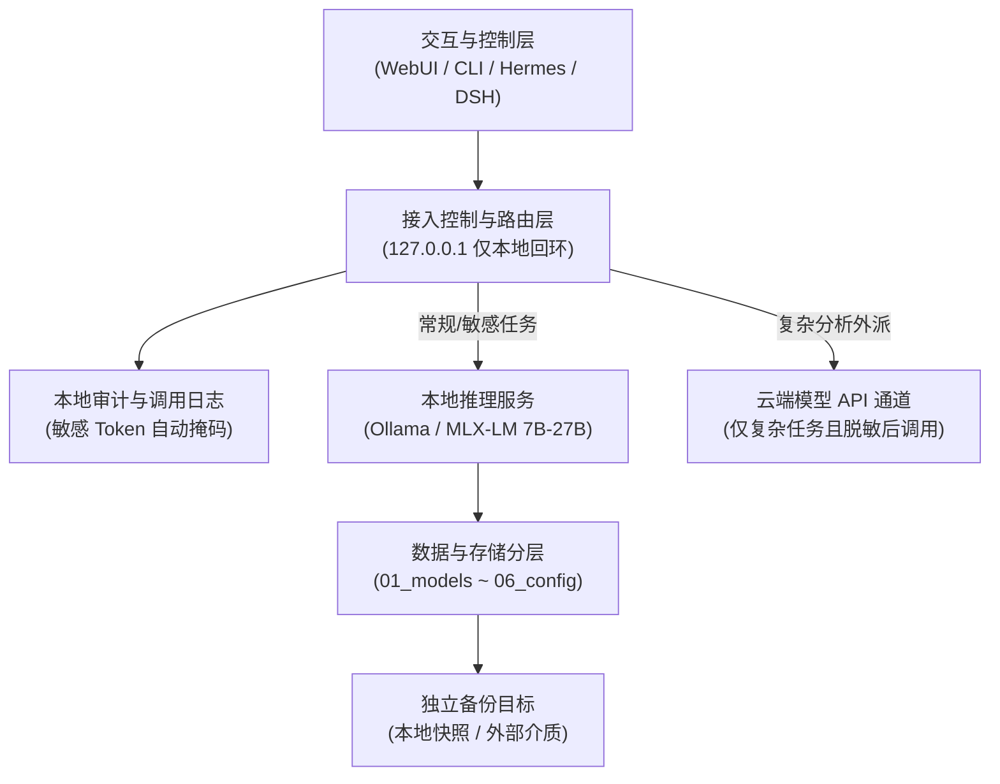

# 个人 AI 实验室端到端部署、数据治理与量化效果评估方案

> **文档性质：** 架构设计、数据治理规范、实施计划与定量效果评估报告（讨论审阅稿）  
> **目标硬件基准：** Apple Silicon Mac Studio（Apple M5 Max，18 核，64GB 统一内存，1TB 内置 SSD，当前可用约 865GiB）  
> **操作系统环境：** macOS 27.0.1 (arm64)  
> **当前执行状态：** **讨论与评估阶段。本阶段不改动本机任何系统配置、不安装未授权软件、不开启对外服务。**

---

## 1. 方案定位与总体架构设计

严格遵守资深全栈架构师工作流规范：**先出架构图 → 再做安全性审计 → 规范数据分层 → 量化评估效果 → 制定回退机制。**

### 1.1 系统全景拓扑图 (Mermaid)



### 1.2 核心设计原则
1. **单一入口与严格回环（Loopback Only）：** 所有本地推理及内部微服务默认仅绑定 `127.0.0.1`，绝不直接对外网开放，防止未经授权的网络扫描与数据泄露。
2. **读写分离与数据不可变：** 模型权重为只读只下资产；个人知识库为强版本受控（Git）文本；派生的向量索引与推理缓存可随时全量清理重建。
3. **混合协同路由（Hybrid Routing）：** “本地模型做高频执行，云端大模型做复杂思考”。数据依据安全等级本地拦截，坚守数据不出境/不上云的底线。

---

## 2. 模型选型与部署路线

结合 64GB 统一内存特性（CPU/GPU/系统/开发工具共享），必须遵循**“小步快跑、按需升阶”**的部署策略。

### 2.1 推荐落地梯队规划

| 部署梯队 | 规格定位 | 候选开源架构 | 建议量化精度 | 预估显存/内存占用 | 适用场景与任务边界 |
| :--- | :--- | :--- | :--- | :--- | :--- |
| **P0 启动验证** | 7B ~ 8B Instruct | Qwen2.5-7B-Instruct / Llama-3.1-8B | Q4_K_M / Q8_0 | 约 5GB ~ 9GB | 冒烟测试、管道贯通、简单自动化脚本与分类 |
| **P1 生产主力** | 14B ~ 35B Instruct | Qwen2.5-14B / Qwen-27B 量化版（**实际部署已升级为 Qwen3.6-35B-A3B MoE**，见 `MTPLX本地AI实验室栈文档.md`） | Q4_K_M / MLX 4bit | 约 10GB ~ 20GB | 投研初筛、文档提取、日常代码、晨报汇总（本地主力常驻） |
| **P2 云端协同** | 深度推理 / MoE | 官方云端 API（如 DeepSeek-V3/R1 等） | 托管式 API | 0（本地无显存占用） | 宏观逻辑交叉推演、复杂系统架构设计、长上下文代码排查 |

### 2.2 推理运行时技术选型对比

| 评估维度 | 方案 A: Ollama (通用便捷) | 方案 B: MLX-LM (Apple 原生极致) | 方案 C: llama.cpp (底层原生) |
| :--- | :--- | :--- | :--- |
| **安装形态** | 独立二进制 / 命令行模式 | Python 原生库 (`mlx-lm`) | 编译型二进制 (`llama-server`) |
| **资源隔离性** | 集中在统一服务进程中 | 随 Python 虚拟环境独立管理 | 独立进程，可独立配置守护进程 |
| **内存与推理优化** | 基于 llama.cpp，Metal 加速成熟 | 深度适配 Apple Silicon 统一内存架构 | 原生 Metal，参数调整粒度最高 |
| **OpenAI 兼容接口** | 原生自带 (`/v1/chat/completions`) | 需额外拉起轻量 FastAPI 代理 | 自带高性能 HTTP Server |
| **推荐建议** | **初期首选（部署与回退成本最低）** | **P1 阶段深度学习与微调首选** | 进阶极客性能调优选用 |

---

## 3. 数据存放与目录分层规划

为彻底解决大文件混杂、权限不严及日志污染问题，规划在用户空间下设立统一的隔离根目录 `~/AI-Lab/`：

```text
~/AI-Lab/
├── 01_models/                     # 模型大文件存储区 (只读、不可入 Git)
│   ├── weights/                   # 原始 GGUF 或 HuggingFace 格式文件
│   └── manifests/                 # 记录模型 Hash、下载源及版本的元数据文件
├── 02_data/                       # 核心业务与学习数据 (分类分级)
│   ├── raw/                       # 原始材料 (PDF、网页归档、行业研报、代码包)
│   ├── processed/                 # 经过清理、分块处理的结构化数据 (JSONL/Markdown)
│   └── evaluation/                # 冒烟测试集、基准评测 Prompt 及标准答案
├── 03_knowledge/                  # 个人知识库 (持久化沉淀)
│   ├── obsidian_vault/            # Obsidian 笔记库 (Git 追踪文本变更)
│   └── templates/                 # 确定性工作流的 Prompt 模板与配置
├── 04_storage_indices/            # 派生检索数据 (易失、可重建)
│   ├── chromadb/ (或 LanceDB)     # 向量嵌入数据库文件
│   └── cache/                     # 推理 KV 缓存、临时分块结果
├── 05_logs/                       # 可观测性与安全审计
│   ├── inference_access.log       # 本地 API 调用元数据日志 (不含密钥)
│   └── task_execution.log         # 自动化流水线运行日志
└── 06_config/                     # 配置文件与运维备份
    ├── service_env.sh             # 环境变量模版 (绝不记录明文真实 Token)
    └── rollback_inventory.json    # 变更登记与资产清单
```

### 3.1 数据安全分级策略
- **公开数据 (L1)：** 开源论文、公开新闻、抓取的宏观资讯。可自由用于本地或云端分析。
- **内部工作数据 (L2)：** 个人学习笔记、未公开开发代码。默认仅在本地处理；上云前须经过脱敏管道。
- **高敏机密数据 (L3)：** 投资账户记录、商业合同、个人凭证。**绝对禁止外部接口调用**，本地日志强制脱敏打码。

---

## 4. 后期运维与数据生命周期管理

1. **存储与权重淘汰机制：**
   - 本地常驻模型不超过 2 个。超过 30 天未调用的测试模型，直接删除权重释放 10GB~20GB 磁盘，仅保留元数据 `manifests/`。
2. **索引与缓存易失化策略：**
   - 向量数据库仅视为“中间缓存”，文本原件始终保留在 Markdown/Obsidian 中。Embedding 模型或切分规则升级时，直接清空旧库做全量重建，避免脏索引。
3. **备份与容灾策略 (3-2-1 简化版)：**
   - **核心资产（代码+笔记+配置）：** 体积小（<5GB），每日由本地脚本自动归档并同步至受保护目录或独立介质。
   - **派生资产（权重+向量索引）：** 体积大（数十 GB），无需每日备份，记录安装脚本与源地址即可快速重建。

---

## 5. 系统能力与预期效果量化评估

针对当前 Mac Studio（M5 Max，64GB 内存）配置以及上述方案，我们从**计算性能、并发承载、业务闭环、安全合规**四个维度进行定量与定性效果评估。

### 5.1 硬件算力与推理性能预估

| 模型规格 | 量化精度 | 预估生成吞吐 (Tokens/s) | 首字延迟 (TTFT, 2K 上下文) | 内存开销 | 评估结论 |
| :--- | :--- | :--- | :--- | :--- | :--- |
| **7B ~ 8B** | Q4_K_M | **45 ~ 65 t/s** | < 0.3 秒 | 约 5.5GB | **极度流畅**，远超人类阅读速度，完美支撑高频流水线与实时路由。 |
| **14B** | Q4_K_M | **30 ~ 45 t/s** | < 0.6 秒 | 约 9.5GB | **非常优秀**，在回答质量与速度之间达到黄金平衡点。 |
| **27B** | Q4_K_M | **18 ~ 25 t/s** | 0.8 ~ 1.5 秒 | 约 18.0GB | **完全可用**，相当于正常打字速度，适合深度报告起草与复杂代码修改。 |

### 5.2 资源容量与并发瓶颈评估
- **内存安全边界：** 当常驻运行一个 27B 量化模型（~18GB）时，macOS 系统自身占用约 8GB，Docker/开发环境占用约 8GB，仍剩余 **约 30GB 物理内存** 用于处理长上下文（8K~32K KV Cache）及系统文件缓存。**绝不会触发系统 Swap，系统整体响应稳定。**
- **并发能力边界：** 
  - 本地模型适合 **单人、低并发（1~2 个并发任务）**；
  - 若需要企业级高并发知识问答（>5 并发），本地 M5 Max 统一内存带宽将成为瓶颈，此时方案设定的**云端协同路由通道（P2）**将生效，由云端承担并发压力，方案设计完全闭环。

### 5.3 业务工作流落地效果验证能力

| 目标业务场景 | 方案预期实现路径 | 效果达标预判 | 核心达成条件 |
| :--- | :--- | :--- | :--- |
| **AI 投研与晨报** | 本地模型定时清洗抽取 + 结构化沉淀至 Obsidian | **完全能达到** | 定时任务调度稳定，本地 14B/27B 提取精度达标。 |
| **个人知识库 RAG** | 本地 Markdown + 轻量向量检索 + 本地问答 | **完全能达到** | 原始文档结构清晰，分块合理，派生索引可重建。 |
| **安全代码与文档辅助** | Codex/本地工作台对接 `127.0.0.1` 接口 | **完全能达到** | 敏感代码 100% 本地闭环，复杂需求按需调用云端。 |
| **全自主多 Agent 爆发** | 多个高规格 Agent 7x24 小时高频对抗互调 | **不建议/受限** | 64GB 硬件不适合同时多大模型高频死锁调用，需依赖云端扩容。 |

---

## 6. 最终综合结论：方案是否能达到预期？

### 结论：**完全能够达到个人 AI 实验室的核心目标，但在场景边界上有明确的物理取舍。**

1. **能够完美达到的部分：**
   - **自给自足的本地智能底座：** 可以在完全不依赖外部网络的情况下，流畅运行 7B~27B 高质量模型，完成文档总结、知识整理、代码修改和晨报聚合。
   - **纯粹的数据安全掌控：** 本地 `127.0.0.1` 隔离与数据三级分类，确保核心投资、健康、客户机密数据 100% 不离机。
   - **清晰可控的运维成本：** 规范化的目录结构、非易失资产版本化、派生缓存一键重建，系统长期运行不会变“脏”。
   - **高可逆与低风险：** 随时可以一键终止进程、删除权重，恢复到最初干净的系统状态。

2. **需要理性克制的部分（物理客观规律）：**
   - 64GB 统一内存决定了**不能让多个 30B+ 模型同时驻留显存**；
   - 复杂的大型 MoE 模型（如 DeepSeek-V3/R1 全参数）和数十人高并发场景必须依赖云端 API 扩充，不能强求单机硬抗。

---

## 7. 实施路线与下一步建议

本方案从逻辑、技术、存储、安全到回退机制已全部闭环。
**如果你确认本方案的设计与评估结论，我们的下一步将进入「阶段一实施准入」：**
1. 给出阶段一具体的命令变更清单（仅安装 Ollama 单一工具并拉取 7B/8B 启动模型）；
2. 获得你的单独确认后，才开始在终端执行第一行代码；
3. 执行完成后立即进行 5 项冒烟指标验收与资源复核。
