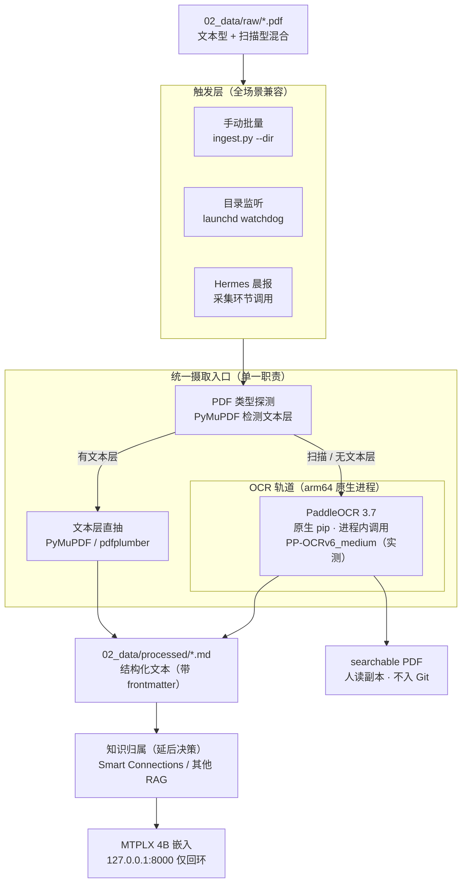

# PDF 摄取方案与安全审计（第二大脑 · 文档 ingestion 管线）

> **文档性质：** 架构设计 + 安全审计 + 实施路线（讨论审阅稿）
> **设计依据：** `rule.md`（先架构图 → 再安全审计 → 后编码）、`个人AI实验室建设与部署方案.md`（数据分层）、`AI实验室部署设计与安全审计.md`（回环/鉴权基线）、`2026-10-15-工作小结`（已落地底座）、参考方案 `e703/ocr-book-pipeline`（PaddleOCR 容器化 OCR）
> **当前执行状态：** 设计收口，进入部署测试（阶段 0–1）：arm64 原生 venv 安装 + 双轨 `ingest.py` + 两个测试 PDF 验证。设计文档已据 M5 Max（arm64）环境从原 x86/Docker 方案调整为原生 pip 部署。
> **核心结论：** 文本型 PDF 走 PyMuPDF 直抽，扫描/无文本层 PDF 走本地 PaddleOCR（**arm64 原生 pip 安装、进程内调用、无容器**，取消原 x86 方案的 Docker 形态），统一产出 `processed/*.md` 规范文本；摄取产物与"知识归属"解耦，后者作为延后决策。

---

## 一、PDF 处理定位与目标

### 1.1 在整体数据分层中的位置

依据 `个人AI实验室建设与部署方案.md` 的 `~/AI-Lab/` 分层，PDF 已被规划进原始材料区：

```text
~/AI-Lab/
├── 02_data/
│   ├── raw/          # PDF、网页归档、行业研报、代码包（原始，不入 Git）
│   └── processed/    # 经过清理、分块处理的结构化数据（Markdown / JSONL）
├── 03_knowledge/
│   └── obsidian_vault/   # Obsidian 笔记库（Git 追踪文本变更）
└── 04_storage_indices/   # 派生检索数据（向量库，易失、可重建）
```

PDF 摄取链路 = **`raw/*.pdf` → 统一摄取入口 → `processed/*.md` +（可选）可搜索 PDF → 知识归属前端（待定）**。

### 1.2 设计目标

1. **覆盖全场景 PDF 类型**：文本型（有文本层）与扫描/图片型（无文本层）统一处理，不漏类型。
2. **本地闭环、零出境**：OCR 与文本抽取均在本机完成，高敏（L3）资料文字层不外发任何第三方。
3. **与知识归属解耦**：摄取只负责"把 PDF 变成规范 Markdown"，至于 Markdown 被哪个 RAG 前端消费，独立决策（见第八章）。
4. **产物可重建**：原始 PDF 是唯一真相源，`processed/*.md`、可搜索 PDF、向量索引均可由脚本全量重建。
5. **全触发兼容**：手动批量、目录监听、Hermes 晨报采集三种触发都要支持，共用同一摄取入口。

---

## 二、目标架构图（组件 / 数据流）



**图例与职责**
- **实线**＝数据流（原始 PDF → 摄取入口 → 规范文本 → 知识前端 → 本地嵌入）。
- **虚线边界**＝安全域（MTPLX 等内部微服务仅 `127.0.0.1` 回环，绝不暴露公网/局域网；OCR 改为进程内调用，无对外端口）。
- **一个能力一个主负责人**：文本抽取（PyMuPDF）与 OCR（PaddleOCR 原生进程）职责分离；摄取入口只做"探测 + 调度 + 规范化输出"，不内嵌业务检索逻辑。
- **解耦点**：`processed/*.md` 是摄取与检索之间的契约接口，下游无论用 Smart Connections 还是其他，都消费同一份产物。

---

## 三、组件职责与交互协议

| 组件 | 职责边界 | 交互协议 | 数据持久化 |
| :--- | :--- | :--- | :--- |
| **触发层（3 种）** | 决定"何时跑"，不直接处理 PDF | 统一调用 `ingest.py` CLI / 函数入口 | 无（仅调度） |
| **PDF 类型探测** | 用 PyMuPDF 判断是否有可用文本层 | 进程内函数调用 | 无 |
| **文本层直抽** | 文本型 PDF 高保真抽取（文本/表格/基础版式） | 进程内（PyMuPDF `get_text`） | 输出 `processed/*.md` |
| **PaddleOCR 原生进程** | 扫描/无文本层 PDF 的 OCR，产出文字层 + 可搜索 PDF | 进程内 Python API 调用（无 HTTP 服务、无对外端口） | 直接写 `processed/` 与 `searchable/` |
| **规范文本 `*.md`** | 摄取与检索的契约产物（含 frontmatter：来源/页数/哈希/摄取时间/轨道） | Markdown 文件 | `02_data/processed/`（文本，可入 vault） |
| **可搜索 PDF** | 人读副本（保留原版式 + 文字层，便于核验/复制） | PDF 文件 | `02_data/processed/searchable/`（不入 Git） |
| **知识归属前端** | 消费 `*.md` 做嵌入与检索（待定） | 文件读取 | 见延后决策 |

---

## 四、关键技术选型

### 4.1 文本型 PDF：PyMuPDF（fitz）

- **理由**：解析能力强，支持文本/表格/图片提取，且可纯 `pip` 安装进隔离 venv，**无 brew 依赖**（本机无 homebrew/macports/nix）。
- **探测逻辑**：`doc.get_text("text")` 非空且字符数超阈值 → 判定为文本型，直抽；否则降级到 OCR 轨道。
- **备选**：`pdfplumber`（纯 Python、表格友好），作为 PyMuPDF 异常时的兜底。

### 4.2 扫描型 PDF：PaddleOCR 3.x 原生 arm64 部署（参考 `e703/ocr-book-pipeline` 的管线逻辑）

> **关键修正（相对原 x86 方案）**：原方案的 Docker 容器化与版本钉死，是被那颗特定的 x86 CPU 逼出来的妥协，**在 M5 Max（arm64）上不应照抄**。核实结论：PaddlePaddle **官方原生支持 arm64 macOS 的 pip wheel**；而 **PaddleOCR 官方 Docker 镜像不支持 Apple Silicon**。因此本机走 `pip install paddlepaddle paddleocr` 装进隔离 venv，是最干净、官方支持、零新增系统依赖的路径，也契合我们"无 brew、venv 隔离"的约定，并彻底消除 Rosetta 仿真风险。

- **为什么能本地装、不必用容器**：PaddlePaddle 官方提供 Apple Silicon 原生 wheel，无需 brew、无需 Docker；参考方案靠 Docker 是为了 x86 可复现，对我们使用场景无意义。
- **arm64 专属坑（必避，替代原 x86 的 MKLDNN 坑）**：PaddleOCR 3.x 在 macOS ARM 默认开启 3 个预处理模型（文档方向 `use_doc_orientation_classify`、弯曲矫正 `use_doc_unwarping`、文本行方向 `use_textline_orientation`），会吃 **40GB+ 常驻内存**把系统卡死；社区实测全部关闭后降到 **<1GB**。初始化时必须显式设为 `False`。
- **版本取向（实测校正）**：实际安装 `paddlepaddle 3.3.1` + `paddleocr 3.7.0`，默认加载 **PP-OCRv6_medium_det / PP-OCRv6_medium_rec**，在 arm64 原生环境**开箱即用地正常加载**。原方案"v6 在 3.0.0 镜像无法加载"是 x86 镜像的限制，arm64 不存在——故**不必**像原方案那样降级钉 `PP-OCRv4 mobile`。**PaddleOCR-VL 不支持 Apple Silicon，仍禁用**。
- **管线逻辑（从参考方案移植，引擎无关）**：去透色、去倾斜、CLAHE 增强、横/竖/多栏读取顺序排序、中文 wqy-zenhei 字体——这些图像预处理与版面复原逻辑有价值，保留并实现在本地批处理脚本中。
- **形态**：进程内 Python API 调用（无 HTTP 服务、无对外端口），由 `ingest.py` 直接 import 调用，输出文字层 + 可搜索 PDF 到 `processed/`。

### 4.3 类型探测与降级

```text
ingest(pdf):
    if has_text_layer(pdf):          # PyMuPDF 检测
        md = extract_text(pdf)       # 高保真、快
    else:                            # 扫描/图片型
        md, searchable = ocr_text(pdf)        # 原生 PaddleOCR 进程内调用
    write processed/<name>.md        # 带 frontmatter
    optionally write searchable/<name>.pdf
```

### 4.4 初测基线（M5 Max · 2026-10-16 部署测试）

| 指标 | 实测值 | 备注 |
| :--- | :--- | :--- |
| 文本轨道（30 页报告） | **0.1s** / 11236 字符 | PyMuPDF 直抽，开销可忽略 |
| OCR 初始化 | 25.5s（含 76.5MB 模型下载，后续命中缓存） | 模型落在 `~/.paddlex/official_models` |
| OCR 速度（200 DPI, 4 线程） | **13.4s/页** | 414 页全书预估 **约 92 分钟**（单进程） |
| OCR 内存峰值（8 线程） | 7779 MB | 高于社区 <1GB 说法，但远低于 40GB+ 爆内存坑 |
| OCR 识别质量 | 中英文混排、ISBN/CIP 数据准确 | 与参考方案 ~96% 召回量级一致 |
| 轨道判定 | 文本型 avg 360.9 字符 / 扫描型 avg 0.2 字符 | 分流边界清晰，两个样本均未误判 |

> **初测结论**：92 分钟单进程吞吐 + 8.9GB 内存偏高 → 已做参数调优，见 4.5。

### 4.5 参数调优：资源消耗优化（同日完成）

初测基线资源开销偏高，故做了一轮参数基准（工具：`ocr_bench.py`；方法：每个配置在**独立子进程**运行以避免内存读数互相干扰，并以基线识别文本做相似度比对作为质量参照）。

| 配置 | 秒/页 | 峰值内存 | 字符数 | 质量相似度 |
| :--- | ---: | ---: | ---: | ---: |
| A 基线 v6_medium/200DPI/4线程 | 14.06 | 8913 MB | 2153 | 1.000 |
| B v6_small/200 | 4.41 | 3932 MB | 2037 | 0.940 |
| C v6_small/150 | 3.60 | 2108 MB | 1980 | 0.927 |
| **D v6_tiny/150** | **1.35** | **1757 MB** | 2046 | 0.922 |
| E v6_small/150/**2线程** | 3.60 | 2108 MB | 1980 | 0.927 |
| F v6_small/200/**det640** | 4.41 | 3923 MB | 2037 | 0.940 |

**三个杠杆的实测结论**：

1. **模型档位是主导杠杆**：`medium → tiny` 提速 **10.4 倍**、内存降至 **1/5**（8913 → 1757 MB）。
2. **渲染 DPI 是有效次级杠杆**：200 → 150 使内存再降 46%（3932 → 2108 MB）、耗时降 18%。
3. **线程数与 `text_det_limit_side_len` 在 paddlex 3.7 下无效** —— E / F 与对照组数值完全一致，说明参数未被采纳。**不再作为调优旋钮**（已同步从 `ingest.py` 移除线程参数，避免留下无效开关）。

**质量核验（关键，决定降档是否安全）**：相似度 0.92~0.94 的差距主要来自**全角/半角标点归一化**（`？` vs `?`、`）` vs `)`）与省略号 `……` 的丢失，**并非实质性错字**。人工比对三档对同一页中文正文的输出，"三弯两绕 / 兹后 / 未臻全面 / 不枉一遭" 等均识别正确，正文可靠性无差异 → **降档安全**。

**档位化设计（已落地 `ingest.py` 的 `OCR_PRESETS`）**：

| 档位 | 模型 | DPI | 秒/页 | 内存 | 414 页全书 | 适用场景 |
| :--- | :--- | ---: | ---: | ---: | ---: | :--- |
| `fast` | PP-OCRv6_tiny | 150 | 1.35 | ~1.8 GB | **实测 9.5 分钟**（570s / 1.37s 每页） | 清晰印刷体（批量书稿推荐） |
| `balanced`（默认） | PP-OCRv6_small | 150 | 3.60 | ~2.1 GB | 约 25 分钟 | 通用，兼顾版面密度较高者 |
| `quality` | PP-OCRv6_medium | 200 | 14.06 | ~8.9 GB | 约 97 分钟 | 小字号 / 低质量扫描件才启用 |

> **全书实测（414 页扫描书，`fast` 档）**：570 秒完成，产出 335,220 字符、667KB 的 `*.md`，
> 以及 48MB 可搜索 PDF；实测 1.37s/页，与基准预测 1.35s/页吻合。
> **相比初测基线档的约 97 分钟，提速 10.2 倍，内存降至约 1/5** —— 无需多进程并行即可满足批量入库。

> **命名坑（实测踩到）**：PP-OCRv6 系列档位为 **medium / small / tiny**，**没有 mobile**（mobile 属 v4/v5 系列）。直接写 `PP-OCRv6_mobile_det` 会报 `No engine bindings registered`。

---

## 五、安全审计（部署前必过）

沿用 `AI实验室部署设计与安全审计.md` 的审计框架，针对 PDF/OCR 增补以下评估：

### 5.1 身份鉴权
- **现状**：MTPLX 已 `--api-key`（`<MTPLX_STATE_DIR>/api-key`，权限 600）；PaddleOCR 改为 **arm64 原生进程内调用**（取消原 x86 方案的 Docker REST 服务），**不存在对外 HTTP 端口**，攻击面较原容器方案显著缩小。
- **风险（低危）**：无监听端口，无未授权远程读取 PDF 文字层风险；远程节点若要使用 OCR，须经 Tailscale 加密隧道在远端本机各自运行原生进程，而非暴露本机端口。
- **措施**：OCR 全程进程内完成，不开启任何监听；如需跨节点，复用 Tailscale + 各节点本地部署原生 PaddleOCR 的模式，**绝不**把 OCR 暴露到公网/局域网。

### 5.2 访问控制
- **措施**：与 MTPLX、Open WebUI 同一策略——所有内部微服务默认 `127.0.0.1`；跨节点访问仅经 Tailscale 加密隧道。OCR 容器 `--memory` 设上限，避免挤占 27B 模型内存预算。

### 5.3 输入校验 / 提示注入
- **风险（中危）**：OCR/抽取出的文本会作为上下文喂给模型（无论走哪个 RAG 前端）。若 PDF 含"指令式文本"（粘贴的网页/邮件），可能触发提示注入。
- **措施**：RAG 上下文与系统指令严格分离；摄取产物只做"检索+总结+问答"，不授予写文件/执行命令/调用外部 API 权限（与现有第二大脑原则一致）。

### 5.4 敏感数据边界
- **现状**：文本抽取与 OCR 均本地完成，零出境。✅
- **风险**：L3 高敏 PDF（合同/财务/健康）一旦误经云端 OCR 即违规。
- **措施**：**所有 OCR 走本地容器，禁止任何云端 OCR**；L3 资料建议分目录/分 vault 单独设权；可搜索 PDF 等二进制不进 Git、不跨节点同步。

### 5.5 第三方依赖安全
- **Python 包（官方源）**：PaddlePaddle / PaddleOCR 用官方 pip wheel（arm64 macOS 原生支持），版本取 3.x 稳定版并钉死 minor，不从不明 PyPI 源安装；PyMuPDF / pdfplumber 同在隔离 venv 内安装，不污染系统环境。
- **供应链校验**：安装后记录 `pip freeze` 锁定版本与 sha，便于复现与审计。

### 5.6 原生进程安全（PaddleOCR arm64）
- 取消容器后，无镜像/挂载面；进程以当前用户身份运行（非 root 系统账户）；通过环境变量/参数关闭三个预处理模型（见 4.2）将常驻内存从 40GB+ 降到 <1GB，避免挤占 27B 模型内存预算；不读取 `<MTPLX_STATE_DIR>/api-key` 等敏感目录。

### 5.7 持久化与合规
- `raw/*.pdf` 与 `searchable/*.pdf` 为二进制大文件，进 `.gitignore`，不进 Obsidian Git vault（避免同步膨胀 + 版权/敏感泄露）。
- 参考方案自带 `.gitignore` 排除版权书 PDF —— 提醒：**受版权材料（书籍/研报）OCR 需合规**；L3 更要本地隔离，绝不外发。

### 审计结论
- 风险**可控**，核心面（进程内调用、本地零出境、文本产物入 vault）已具备；**最需盯防**的是 PaddleOCR 三预处理模型内存爆（见 4.2/5.6）与提示注入，以及二进制文件的 Git/同步外泄。
- 放行条件：OCR 容器仅 `127.0.0.1` 映射 + 二进制全部 `.gitignore` 排除 + 下游 RAG 不授予写/执行权限。满足后可进入编码阶段。

---

## 六、数据生命周期与 Git 策略

| 产物 | 位置 | 是否入 Git / vault | 性质 |
| :--- | :--- | :--- | :--- |
| 原始 PDF | `02_data/raw/` | **否**（`.gitignore`） | 真相源，只读 |
| 规范文本 `*.md` | `02_data/processed/` | **是**（文本，进 vault 被检索） | 契约产物，可重建 |
| 可搜索 PDF | `02_data/processed/searchable/` | **否**（`.gitignore`） | 人读副本，可重建 |
| 向量索引 | `04_storage_indices/` | 否（易失，可重建） | 派生缓存 |

- **索引易失化**：文本原件（md）始终保留，embedding 模型或切分规则升级时直接清空旧库全量重建。
- **重建性**：原始 PDF 不动，任何下游产物均可由 `ingest.py` 全量重跑。

---

## 七、触发机制实现设计（全场景）

三种触发器共用同一摄取入口 `ingest.py`，保证行为一致：

1. **手动批量（起步默认）**：`python ingest.py --dir 02_data/raw [--name x]` 处理指定目录/文件，简单可控，先验证质量。
2. **目录监听（launchd watchdog）**：以 `watchdog`（pip 装进 venv）监听 `raw/` 新增文件 → 触发 `ingest`；由 launchd plist 常驻保活，复用现有 `com.user.*` 模式（plist 权限 644、不含明文密钥、`StandardOutPath` 接管日志、`KeepAlive`）。
3. **Hermes 晨报集成**：作为 Hermes 采集环节的一个 step 调用 `ingest`（需 Hermes 先装上，目前未装）；适合把每日新增研报/资料自动消化进知识库。

---

## 八、延后决策（与摄取解耦）

1. **知识归属**：`processed/*.md` 最终被哪个 RAG 前端消费——Obsidian + Smart Connections（方案 Y 已定调）还是其他——**单独讨论**，不影响摄取管线设计。摄取只保证产出规范 Markdown。
2. **arm64 原生路径已确定（原 Rosetta 风险消除）**：改用原生 pip 后不再依赖 OrbStack Rosetta 仿真；新需验证的是 Apple Silicon 上 PaddleOCR 3.x 的**三个预处理模型内存爆坑**（关掉后常驻内存从 40GB+ 降至 <1GB），以及 CPU 线程收益（见 4.2、阶段 0）。
3. **分块 / 嵌入参数**：chunk size、overlap、是否保留版面结构喂 MTPLX 4B 嵌入——待归属确定后细化。

---

## 九、实施路线

| 阶段 | 内容 | 关键产出 | 前置 |
| :--- | :--- | :--- | :--- |
| **阶段 0 · 排雷** ✅ 已完成 | 原生 pip 装 `paddlepaddle 3.3.1` + `paddleocr 3.7.0`，关闭三预处理模型后跑通扫描 PDF | OCR 可用；内存峰值 7.8GB（远低于 40GB+ 坑）；13.4s/页 | 无 |
| **阶段 1 · 摄取入口** ✅ 已完成 | `ingest.py`：双轨探测 + 文本直抽/OCR + 规范 `*.md` + 可选可搜索 PDF | 两样本端到端验证通过 | 阶段 0 |
| **阶段 2 · 触发器** | 手动脚本 + launchd watchdog +（Hermes 接入） | 三种触发可用 | 阶段 1 |
| **阶段 3 · 知识归属** | 接入 Smart Connections / 其他，消费 `*.md` 做嵌入检索 | 端到端可问答 | 归属决策 |
| **阶段 4 · 加固** | `.gitignore` 收紧、容器内存上限、审计复核 | 可长期运行 | 阶段 2/3 |

---

## 十、与既有决策的衔接

- **方案 Y（单一知识前端）**：摄取产物解耦，待归属确定后自然对齐，不预先制造第二份索引。
- **回环/进程内基线**：OCR 改为原生进程内调用，无对外端口，比原容器方案暴露面更小；如需跨节点复用 Tailscale + 各节点本地部署模式。
- **零 brew 约束**：PyMuPDF / pdfplumber / watchdog / PaddlePaddle / PaddleOCR 均 pip 进 venv（arm64 原生 wheel），OCR 不再依赖容器，绕开系统包管理器缺失与 Rosetta 仿真。
- **本地 4B 嵌入**：下游 RAG 统一调用 `127.0.0.1:8000` 的 MTPLX 4B，与现有第二大脑 RAG 一致。
