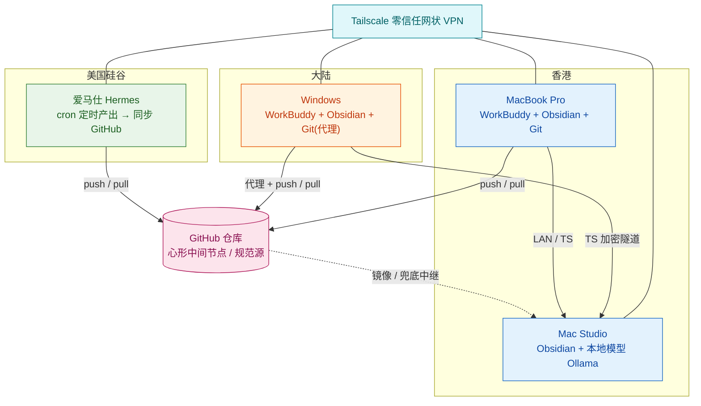
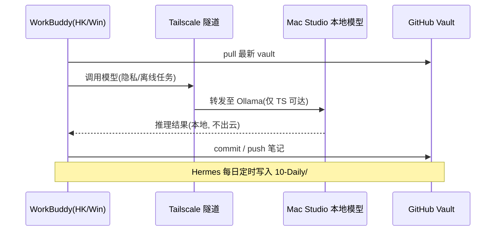

# 第二大脑 · 跨区同步与本地模型部署方案

> 设计依据：《第二大脑部署架构图》+ 项目 `rule.md`（先架构图 → 再安全审计 → 后编码）
> 场景：GitHub 仓库为「心形中间节点」，四叶子节点（硅谷 Hermes / 香港 MBP / 大陆 Windows / 香港 Mac Studio）围绕读写；Mac Studio 额外承担本地模型算力。

## 0. 现状拓扑与目标

GitHub 仓库作为**心形中间节点（canonical hub）**，是 vault 的唯一规范源；四个叶子节点最终与它保持一致。

两大痛点与对策：
- **大陆访问 GitHub 不稳** → 本地代理直连 +（兜底）经香港 Mac Studio 上的 Gitea 中继镜像。
- **本地模型跨区调用** → Tailscale 零信任网状 VPN，把各节点织成一张内网，Mac Studio 模型 API 仅经 Tailscale 暴露，绝不公网开放。

## 1. 架构总览（Mermaid）

## 2. 网络与同步架构

### 2.1 同步链路
- **硅谷 Hermes**：定时（cron）采集/产出 → 写入 vault 的 `10-Daily/YYYY-MM-DD-*.md` 与 `00-Inbox/` → 直接 push GitHub。日期戳文件天然无冲突。
- **香港 MBP**：Obsidian Git 自动 pull / commit / push；HK 本地网络直连 GitHub，稳定。
- **大陆 Windows**：经本地代理（Clash，127.0.0.1:7890）访问 GitHub；或经 Tailscale 先把变更推到 Mac Studio 上的 **Gitea 中继**，再由 Mac Studio 镜像到 GitHub（更稳、兜底）。
- **香港 Mac Studio**：主要作为算力节点；轻量 pull vault 用于本地检索 / 模型上下文，**不做高频写入**以免冲突。

### 2.2 冲突规避（分治 + 高频提交）
- **目录分治**：Hermes → `00-Inbox/` + `10-Daily/`；人为编辑 → `20-Projects/`、`30-Notes/`；归档 → `90-Archive/`。
- **Obsidian Git 设置**：启动自动 pull；每 10–15 分钟 auto-commit + auto-push；push 前强制 pull。
- **.gitignore**：忽略 `.obsidian/workspace*`、插件缓存、临时文件、密钥。
- **冲突处理**：Obsidian Git 标记冲突文件，手动 merge；`daily/` 用日期戳几乎零冲突。

## 3. 本地模型服务（Mac Studio）

- **运行时**：Ollama（最省心起步）/ LM Studio（OpenAI 兼容）/ vLLM（高吞吐）。
- **暴露方式**：`OLLAMA_HOST=0.0.0.0:11434`，但**只监听 Tailscale 接口**，不绑公网网卡。
- **调用**：HK MBP 与大陆 Windows 上的 WorkBuddy 配置自定义 OpenAI 兼容 endpoint = `http://<mac-studio.ts.net>:11434`，经 Tailscale 加密隧道访问。
- **用途分层**：隐私 / 离线 / 长文本 → 本地模型；重负载 / 多模态 → WorkBuddy 云模型。

## 4. 零信任内网（Tailscale）

- 所有节点安装 Tailscale，组成 mesh。
- 收益：① 大陆 Windows 安全访问 Mac Studio 模型，免公网暴露；② 远程维护各节点；③ 替代脆弱的点对点端口映射。
- 可选：Mac Studio 作为 subnet / exit node（谨慎开启，注意合规）。

## 5. 安全审计（上线前必做，依据 rule.md）

1. **身份鉴权**：GitHub 细粒度 PAT，仅授予该仓库 contents 读写；存于系统钥匙串 / Obsidian Git，不落明文；季度轮换。Tailscale 用带过期期的 key / SSO。
2. **访问控制**：仓库私有；模型 API 仅 Tailscale 可达；节点间最小权限。
3. **输入校验 / 注入**：网页剪藏等不可信内容优先本地模型推理，防泄露；WorkBuddy 提示词注意注入防护。
4. **敏感数据加密**：敏感笔记用 git-crypt / Obsidian 加密插件；`.gitignore` + pre-commit 秘密扫描（gitleaks）；绝不提交密钥。
5. **传输安全**：GitHub HTTPS + Tailscale WireGuard，全程加密；模型 API 不经公网明文。
6. **第三方依赖**：Obsidian 社区插件仅装可信来源并锁定版本；定期审查。
7. **备份 / 持久化（3-2-1）**：GitHub(云) + Mac Studio 本地 + 周期性离线备份（restic / 外置盘）。
8. **合规**：大陆代理仅用于合法同步，遵守当地法规；不路由非法流量。

## 6. 分阶段实施路线

| 阶段 | 内容 | 关键产出 |
| :--- | :--- | :--- |
| P0 | 组网 | 全节点装 Tailscale，成 mesh（使能项） |
| P1 | 规范源 | 建 GitHub 仓库、`.gitignore`、目录/分支模型、发放 PAT |
| P2 | 客户端同步 | MBP / Windows / Mac Studio 配置 Obsidian Git，调自动同步与目录分治 |
| P3 | 本地模型 | Mac Studio 部署 Ollama + Tailscale 暴露 API，WorkBuddy 接 endpoint |
| P4 | Hermes 接入 | 硅谷定时流水线写入 `10-Daily/` |
| P5 | 安全加固 | git-crypt、秘密扫描、备份、审计 |
| P6 | 可观测 | 健康检查 / 同步状态看板 |

## 7. 待确认决策点

- 本地模型运行时：**Ollama / LM Studio / vLLM**？（推荐 Ollama 起步）
- 大陆 Windows 走「代理直连 GitHub」还是「经 Mac Studio Gitea 中继」？（建议两者并存：代理为主，Gitea 中继兜底）
- Mac Studio 是否参与高频 Git 写入（建议只读 + 本地检索，避免冲突）。
- 是否需要 GitHub Action 做自动合并 / 清理机器人。
