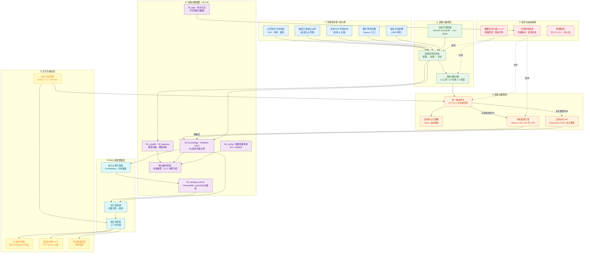

# 第二大脑（Personal AI Lab）部署架构图

> 设计依据：《个人AI实验室建设与部署方案》+ Hermes 双 Profile 调度工作流
> 核心原则：本地优先（127.0.0.1 仅回环）、数据三级分类（L1–L3）、混合协同路由、派生索引可重建、3-2-1 备份

## 架构总览（Mermaid）

## 七层职责说明

| 层级 | 核心职责 | 关键组件 |
| :--- | :--- | :--- |
| ① 外部信息源 | 多渠道内容捕获 | 公开资讯、公众号、文档、邮件剪藏、语音转写 |
| ② 采集与编排 | 定时触发、清洗、分级 | Hermes Scheduler、采集流水线、L1–L3 分类 |
| ③ 智能与推理 | 混合路由与执行 | 本地网关、脱敏审计、本地 LLM、云端 API |
| ④ 存储与数据 | 资产分层与备份 | 模型/原始/知识库/向量/日志/配置 + 3-2-1 备份 |
| ⑤ RAG 增强 | 语义检索与上下文 | 嵌入索引、召回重排、提示词拼装 |
| ⑥ 交互输出 | 人机接口与产物 | 对话、晨报、PPT、知识图谱 |
| ⑦ 安全运维 | 隔离、分级、监控 | 回环隔离、数据分级、可观测性 |

## 关键设计约束

1. **单一入口与回环隔离**：所有推理与内部服务仅绑定 `127.0.0.1`，绝不直接对外暴露。
2. **数据三级分类**：L1 公开可上云，L2 内部默认本地，L3 机密绝对禁止外部调用并强制脱敏打码。
3. **混合协同路由**：本地模型做高频执行，云端大模型做复杂推理（脱敏后外派）。
4. **派生易失化**：向量索引与缓存视为中间产物，可随时全量重建，原件恒留 Obsidian/Markdown。
5. **高可逆**：进程可一键终止、权重可删除，系统可恢复至初始干净状态。
