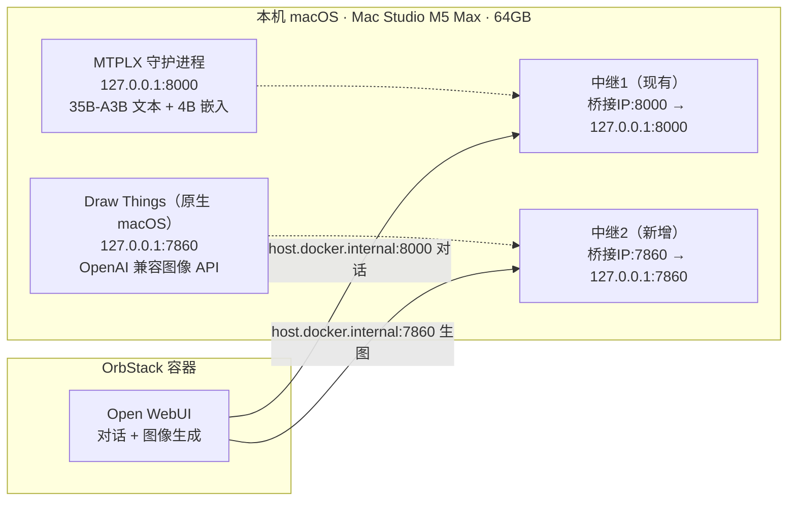

# 图像 / 视频生成接入方案（35B-A3B 对话 + 生图 + 生视频）

> 目标：在**不破坏现有安全架构**（MTPLX 仅回环 + 中继）的前提下，给 Open WebUI 加上本地生图能力，并对生视频给出硬件可行性判断与模型选型。
> 硬件基线：**Mac Studio M5 Max，64 GB 统一内存**。生成模型 35B-A3B（MoE）常驻约 **20.4 GB**（比旧 27B 的 ~33 GB 更省，留给生图/生视频的预算更宽裕）。

---

## 一、硬件快照与可行性结论（先看这个）

| 项目 | 数值 | 含义 |
|---|---|---|
| 芯片 | Apple M5 Max | Metal GPU 可用（仅原生 macOS 程序能用，Linux 容器用不了） |
| 统一内存 | 64 GB | 35B-A3B 常驻 ~20.4 GB，**剩余约 43 GB** 给其它任务 |
| 生成模型 | `mlx-community/Qwen3.6-35B-A3B-4bit`（MoE） | 纯文本大模型，常驻占用 ~20.4 GB（比旧 27B 的 ~33GB 更省） |

**结论（直接回答"建不建议"）：**

- **生图：建议上。** 64 GB 对"35B-A3B + 量化 FLUX/SDXL"是充裕的，且 Draw Things 原生 macOS + Metal，几乎零配置，复用中继后**不新增任何公网暴露**。
- **生视频：能做，但不建议当日常生产用。** Wan2.2 的 **5B** 变体在 64 GB 上能跑，但单条 ~2 秒片段要 ~15 分钟，且必须和生成模型 **错峰**（否则内存顶满会 swap/卡死；不过 35B-A3B 仅 ~20GB，比旧 27B 的 ~33GB 更宽松）；更高质量的 **14B** 变体需要 128 GB，**本机不可行**。高频视频需求需升级到 128 GB。

---

## 二、最小技术方案：35B-A3B 对话 + 图像生成（保持回环 + 中继架构）

### 2.1 核心设计原则

1. **生图后端跑原生 macOS**（Draw Things），**不要**放进 OrbStack 的 Linux 容器——容器拿不到 Mac 的 Metal GPU，只能走 CPU，慢到不可用。
2. **Draw Things 只听 127.0.0.1:7860**（回环），通过**新增一条中继**（复用 `mtplx-relay.py` 的同款 TCP 转发）暴露给容器，安全姿态与 MTPLX 完全一致。
3. Open WebUI 经 `host.docker.internal:7860` 调生图 API，与现有 `:8000` 对话通道并列。

### 2.2 架构图

### 2.3 部署步骤（精简版）

1. **安装 Draw Things**：App Store 或 drawthings.ai/downloads（原生 macOS，免费本地生成）。
2. **开启 API 服务**：设置 → 启用 "OpenAI Compatible API Server"，绑定 `127.0.0.1:7860`，设一个本地 API Key（可选）。
3. **下载起步模型**：`FLUX.1 [schnell]`（GGUF Q8，约 16 GB）。Draw Things 内一键下载。
4. **加中继2**：复制 `mtplx-relay.py` 思路（纯标准库 TCP 转发），端口改 7860，绑定 OrbStack 桥接 IP（同 `bridge100` 真实 IP，即现有中继那个），转发到 `127.0.0.1:7860`。同样接入 launchd 常驻。
5. **Open WebUI 配置**：
   - 管理员设置 → **Images** → 图像生成引擎选 **OpenAI**；
   - Images 的 API Base URL 填 `http://host.docker.internal:7860/v1`；
   - 模型名填 Draw Things 内该模型的标识（如 `flux.1-schnell`）；
   - API Key 填第 2 步设的本地 Key（若未设则留空/任意）。
6. **验收**：OWUI 对话框点"图像生成"出图；`curl http://127.0.0.1:7860/v1/models` 应返回 200。

### 2.4 安全审计（与现有架构对齐）

| 检查项 | 结果 |
|---|---|
| Draw Things 监听面 | 仅 `127.0.0.1:7860`（回环，非 0.0.0.0）✓ |
| 容器可达路径 | 仅经中继2（绑 OrbStack 私有桥接 IP），不暴露 Wi-Fi/局域网/公网 ✓ |
| 鉴权 | 中继透明转发，Draw Things API Key 在末端校验；中继不落盘密钥 ✓ |
| 新增暴露面 | 无新增公网端口，与 MTPLX 同级别 ✓ |
| 常驻 | 中继2 接入 launchd；Draw Things 设"登录自启 + API 常开" ✓ |

> 注意：Draw Things 是 GUI App，**必须保持运行**才能当后端。设"登录时启动"并在设置里勾选 API 服务随应用自启。

### 2.5 内存共存测算

- 35B-A3B 常驻 ~20.4 GB + FLUX.1 schnell Q8 ~16 GB（生图瞬时）≈ **36 GB 峰值**，64 GB 下留 ~28 GB 余量，**可并发**（比旧 27B 方案更宽裕）。
- 若上 FLUX.1 [dev] / Qwen-Image（~24 GB），与生成模型并发会吃紧，建议生图时临时让 MTPLX 卸载或错峰。

---

## 三、生图模型选型（64 GB 基线）

| 模型 | 运行时占用 | 许可证 | 适合场景 |
|---|---|---|---|
| **FLUX.1 [schnell] (Q8)** | ~16 GB | Apache 2.0（可商用） | **起步首选**：4 步出图、快、质量好、商用安全 |
| **SDXL (Q8/fp16)** | ~6–8 GB | OpenRAIL-M（Medium 阈值内可商用） | 最省内存；LoRA / ControlNet 生态最丰富 |
| **Qwen-Image (量化)** | ~20–24 GB | Apache 2.0 | 文字/排版/信息图/海报最强 |
| FLUX.1 [dev] | ~24 GB | **非商用** | 最高保真，但不能商用 |

> 推荐路径：先用 **FLUX.1 [schnell] Q8** 跑通，需要文字渲染再叠 **Qwen-Image**，需要风格化/LoRA 再上 SDXL。

---

## 四、生视频：可行性判断与选型（作为独立工作流）

Open WebUI 对视频生成的支持不成熟，**不建议**把视频塞进对话流，而是用**独立工具**生成后把结果带入。两条本地路线：

### 4.1 路线 A：Draw Things 视频模式（最省事）
Draw Things 已内置 Wan 2.2 / LTX-2 视频生成，原生 Metal，UI 内直接出片。适合偶尔尝试。

### 4.2 路线 B：mlx-video（命令行，可脚本化）
`mlx-video`（Blaizzy）把 Wan2.2 转 MLX，在 Mac 上本地跑。推荐 **Wan2.2-TI2V-5B**：

| 变体 | 磁盘 | 运行时内存峰值 | 许可 | 64 GB 可行性 |
|---|---|---|---|---|
| **Wan2.2-TI2V-5B (q8)** | ~18 GB | ~18–23 GB（接近 bf16） | Apache 2.0 | ✅ 可行，但需与生成模型 **错峰**；~15 min / 2 秒片段 |
| Wan2.2-TI2V-5B (bf16) | ~23 GB | ~56 GB 峰值 | Apache 2.0 | ⚠️ 与生成模型同开必爆，必须单独跑 |
| **Wan2.2-A14B** | ~64 GB | 需 128 GB | Apache 2.0 | ❌ 本机不可行 |

> 实测参照：M3 Max 64 GB 跑 TI2V-5B，720p × 41 帧 × 20 步 ≈ 15 分钟，内存稳定；"64 GB 够，32 GB 不够"。你这台 M5 Max 64 GB 同档。

**操作建议（视频）**：
- 跑视频前先 `launchctl bootout` 或暂停 MTPLX（或仅确保生成模型不在生成中），给 Wan 让出内存。
- 用 TI2V-5B q8 + 低帧数（41 帧 ≈ 1.7 秒）/ 低分辨率起步，确认效果再加大。
- 文字渲染仍是本地视频模型的短板（模型普遍画不好文字），别对"带字幕视频"抱太高期望。

---

## 五、一句话总结

- **生图：上，推荐 FLUX.1 [schnell] Q8 + Draw Things，复用中继，零新增暴露。**
- **生视频：本机只能玩 Wan2.2 5B，慢且要错峰，不适合日常生产；真要高频视频，硬件得升 128 GB。**

> 下一步可选：确认后我可以把"中继2 + Draw Things 配置 + OWUI 图像设置"落成逐条可执行命令，并补齐 launchd plist。
